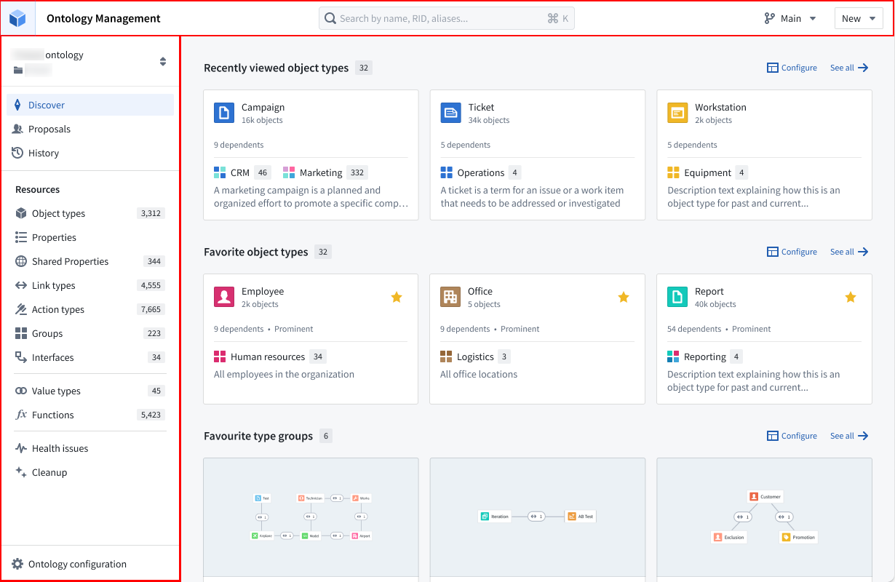
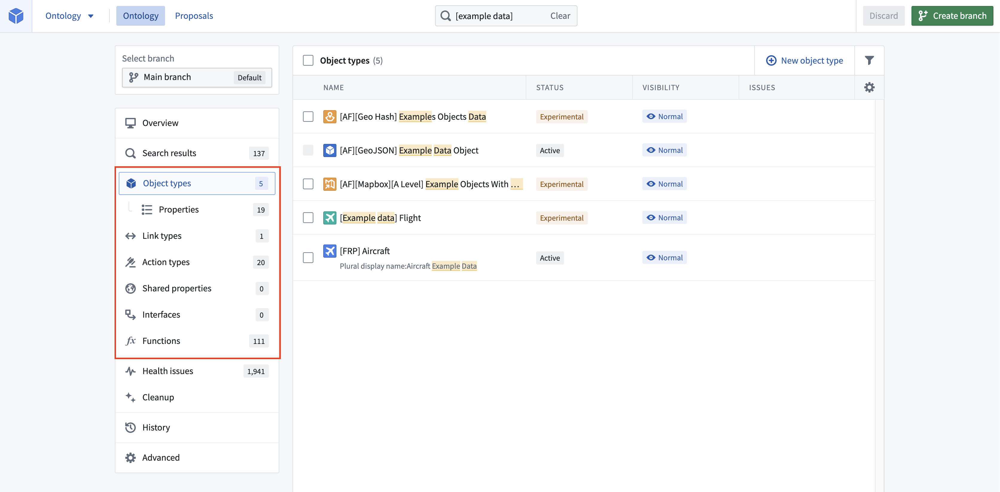
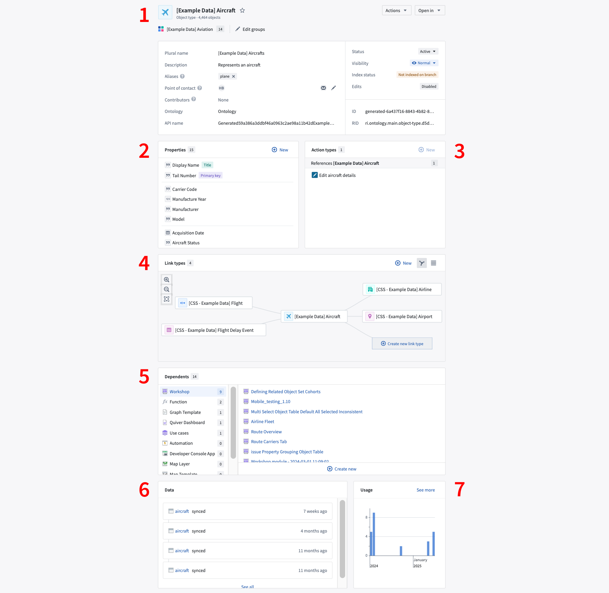
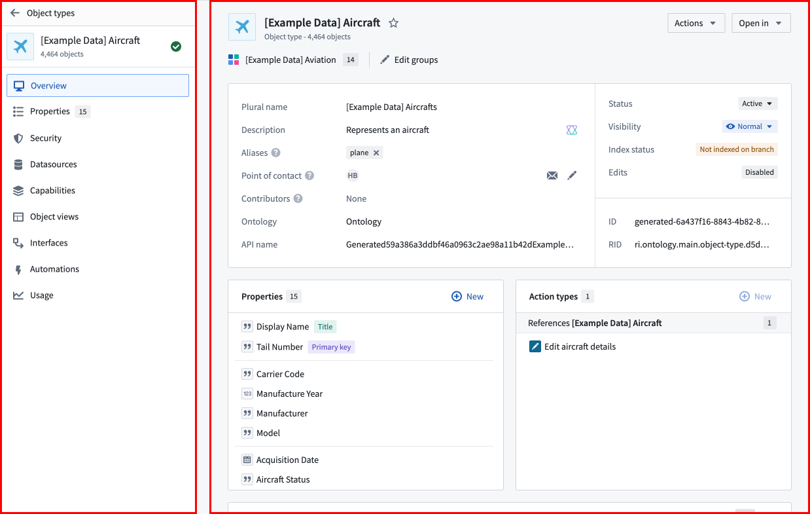
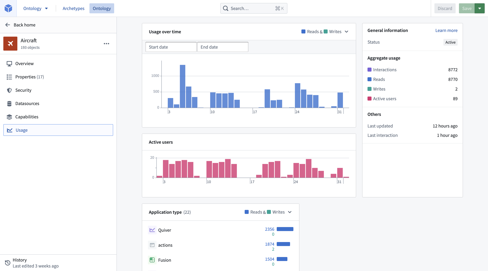
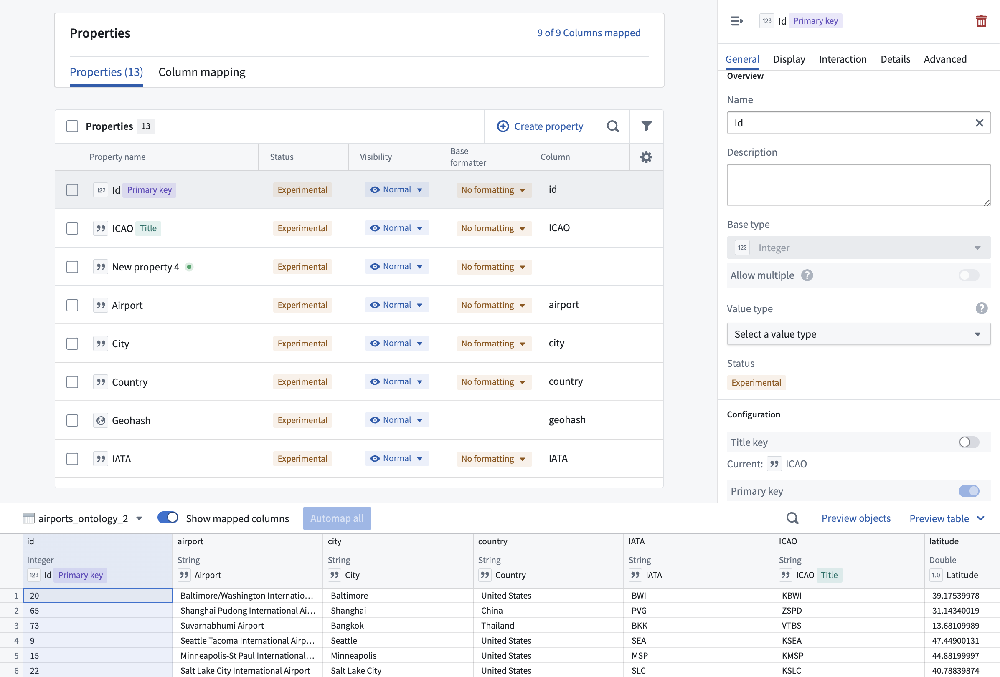
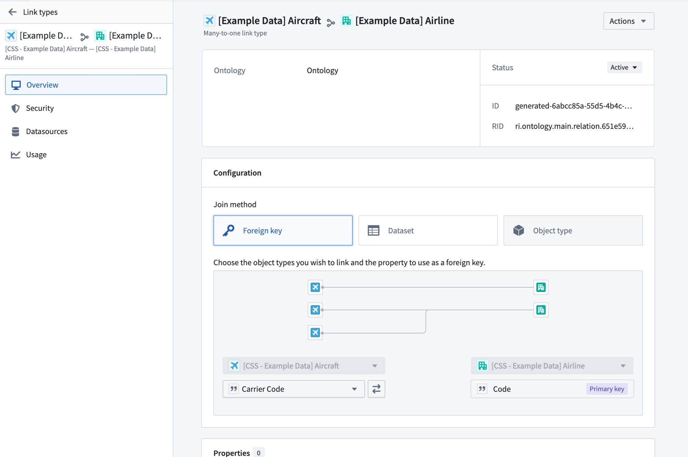
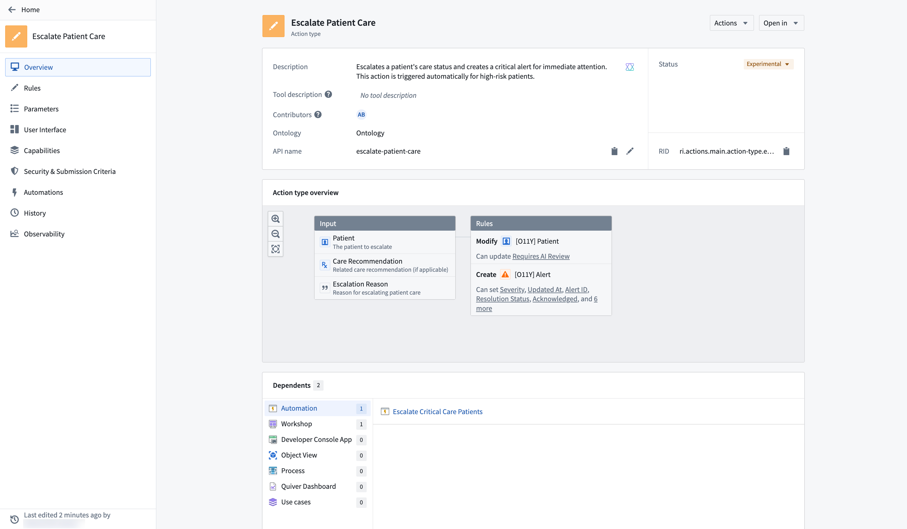

# Palantir Foundry / AIP · Ontology（本体）信息架构与界面结构

> **事实性调研报告**　｜　调研日期：2026-10-09
> 本文只做事实梳理，不包含改进建议或设计方案。

---

## 0. 调研方法与来源可靠性说明

### 0.1 来源分级（全文标注方式）

| 标记 | 含义 |
|---|---|
| **〔官文〕** | Palantir 官方文档正文（palantir.com/docs），逐字取自页面原始 Markdown |
| **〔官图〕** | Palantir 官方文档内嵌截图，已下载并由本人直接读图确认 |
| **〔三方〕** | 第三方教程/博客/视频 | 
| **〔未检出〕** | 官方文档中查不到 |

### 0.2 方法说明（可复现）

palantir.com/docs 的页面正文被超大左侧导航挤压，直接抓取 HTML 只会得到「顶部导航 + 被裁剪的中间 + 尾部导航」。本报告改用如下方法取得**官方页面原始 Markdown**：

1. 抓取页面 HTML；
2. 定位 `<script id="__NEXT_DATA__">`（Next.js SSG 数据块）；
3. 解析 `props.pageProps.markdown` 字段 —— 即该文档页的原始 Markdown 正文。

该方法对本报告引用的全部 50+ 个官方页面均验证有效。可用以下命令复核：

```powershell
$r = Invoke-WebRequest "https://www.palantir.com/docs/foundry/ontology/core-concepts/" -UseBasicParsing
$c = $r.Content
$s = $c.IndexOf('>', $c.IndexOf('id="__NEXT_DATA__"')) + 1
$e = $c.IndexOf('</script>', $s)
($c.Substring($s,$e-$s) | ConvertFrom-Json).props.pageProps.markdown
```

**404 判定依据**：文档站不存在的路径返回 HTTP 200，但正文长度恒为 262659 字节且 `markdown` 为空。本报告所有「不存在」结论均以该特征判定（已用随机路径 `foundry/zzz-definitely-not-real-page-xyz/` 校验）。

### 0.3 本次调研的环境限制（重要）

本次执行环境的网络仅能访问 `palantir.com` 与 `github.com`。以下目标**全部不可达**，因此本报告**未能引入任何第三方来源**：

| 目标 | 结果 |
|---|---|
| `web_search` 工具 | 不可用（无 API key） |
| `blog.palantir.com`（Palantir 官方博客） | HTTP 403（机器人拦截） |
| `google.com` / `duckduckgo.com` / `medium.com` / `en.wikipedia.org` | 连接超时或 SSL 失败 |
| `r.jina.ai`（正文提取代理） | fetch failed |

因此：

- 本报告的**全部结论均来自官方文档与官方文档内嵌截图**；
- 用户点名的「第三方教程/博客」这一来源类别**本次为空**，本报告不以推测填充；
- 官方学习平台 `learn.palantir.com` 的课程链接在文档正文中被大量引用，但该站点本环境不可达，未作核实。

### 0.4 命名与版本观察

官方文档中**不存在**名为 "Ontology Explorer" 的产品或页面（`foundry/ontology-explorer/overview` → 404）。文档首页侧栏中该位置的产品名为 **Object Explorer**〔官文〕。详见 §6。

---

## 1. 本体的核心构成要素

### 1.1 官方总定义

> "An Ontology is a categorization of the world. In Foundry, the Ontology is the digital twin of an organization, integrating the organization's digital assets (datasets and models) into a coherent whole. The Foundry Ontology creates a complete picture of an organization's world by mapping datasets and models to **object types, properties, link types, and action types**."
> ——〔官文〕<https://www.palantir.com/docs/foundry/ontology/core-concepts/>

同一页面紧接着给出四要素的一句话定义（下表的第 1–4 行即原文）：

> "An **object type** defines an entity or event in an organization. / A **property** defines the object type's characteristics. / A **link type** defines the relationship between two object types. / An **action type** defines how an object type can be modified."
> ——〔官文〕同上

### 1.2 逐项官方定义

| 要素 | 官方定义（原文） | 来源 |
|---|---|---|
| **Ontology（本体）** | "a categorization of the world … the digital twin of an organization" | [核心概念](https://www.palantir.com/docs/foundry/ontology/core-concepts/) |
| **Object Type（对象类型）** | "the schema definition of a real-world entity or event"；**object** = 单个实例；**object set** = 多个实例的集合 | [核心概念](https://www.palantir.com/docs/foundry/ontology/core-concepts/)、[对象类型](https://www.palantir.com/docs/foundry/object-link-types/object-types-overview/) |
| **Property（属性）** | "the schema definition of a characteristic of a real-world entity or event"；**property value** = 某对象上该属性的取值 | [核心概念](https://www.palantir.com/docs/foundry/ontology/core-concepts/)、[属性](https://www.palantir.com/docs/foundry/object-link-types/properties-overview/) |
| **Link Type（链接类型）** | "the schema definition of a relationship between two object types"；**link** = 两个对象之间该关系的一个实例 | [核心概念](https://www.palantir.com/docs/foundry/ontology/core-concepts/)、[链接类型](https://www.palantir.com/docs/foundry/object-link-types/link-types-overview/) |
| **Action Type（动作类型）** | "the schema definition of a set of changes or edits to objects, property values, and links that a user can take at once. It also includes the side effect behaviors that occur with action submission." | [核心概念](https://www.palantir.com/docs/foundry/ontology/core-concepts/)、[动作类型](https://www.palantir.com/docs/foundry/action-types/overview/) |
| **Shared Property（共享属性）** | "a property that can be used on multiple object types in your ontology. Shared properties allow for consistent data modeling across object types and centralized management of property metadata. **While property metadata is shared across objects, the underlying object data is not.**" | [共享属性](https://www.palantir.com/docs/foundry/object-link-types/shared-property-overview/) |
| **Base Type（基类型）** | "Base types are used to define properties on objects. The base type of a property determines the set of operations available for that property in user applications. All field types are valid base types except for `Map` and `Binary` types." | [基类型](https://www.palantir.com/docs/foundry/object-link-types/base-types/) |
| **Value Type（值类型）** | "semantic wrappers around a field type comprised of metadata and constraints that can enhance type safety, improve expressiveness, and provide additional context." | [值类型](https://www.palantir.com/docs/foundry/object-link-types/value-types-overview/) |
| **Interface（接口）** | "an Ontology type that describes the shape of an object type and its capabilities. Interfaces provide **object type polymorphism**, allowing for consistent modeling of and interaction with object types that share a common shape." | [接口](https://www.palantir.com/docs/foundry/interfaces/interface-overview/) |
| **Object Type Group（对象类型分组）** | "a classification primitive that helps users better search and explore their ontology" | [对象类型分组](https://www.palantir.com/docs/foundry/object-link-types/type-groups/) |
| **Function（函数）** | "a piece of code-based logic that takes in input parameters and returns an output. Functions are natively integrated with the Ontology: they can take objects and object sets as input, read property values of objects, and be used across action types and applications that build on the Ontology." | [核心概念](https://www.palantir.com/docs/foundry/ontology/core-concepts/)、[函数](https://www.palantir.com/docs/foundry/functions/overview/) |
| **Object View（对象视图）** | "a central hub for all information and workflows related to a particular object. This includes key information about an object, any linked objects, and related metrics, as well as analyses, dashboards, and applications related to the object." | [核心概念](https://www.palantir.com/docs/foundry/ontology/core-concepts/)、[对象视图](https://www.palantir.com/docs/foundry/object-views/overview/) |
| **Struct（结构）** | "an Ontology property base type that lets a single property hold several fields instead of one value" | [结构](https://www.palantir.com/docs/foundry/object-link-types/structs-overview/) |
| **Backing datasource（后备数据源）** | "The source of the data used as property values for objects of this type." | [创建对象类型](https://www.palantir.com/docs/foundry/object-link-types/create-object-type/) |
| **Ontology resource（本体资源）** | "an artifact which stores ontological resources or entities" | [本体](https://www.palantir.com/docs/foundry/ontologies/ontologies-overview/) |

### 1.3 要素之间的关系（官方原文）

**(a) 官方给出的「数据集 ↔ 本体」概念对照表**〔官文〕（[核心概念](https://www.palantir.com/docs/foundry/ontology/core-concepts/) 原样摘录）：

| Datasets | Ontology |
|---|---|
| Dataset | Object type |
| Row | Object |
| Column | Property |
| Field | Property value |
| Join | Link type |

**(b) 类型层 vs 数据层**——官方明确区分「定义」与「实例」〔官文〕（[类型参考](https://www.palantir.com/docs/foundry/object-link-types/type-reference/)）：

> - **Object type definitions**, sometimes just referred to as "object types", refer to **type-level** information about ontology entities such as object types, link types, and action types. For example, the metadata for an object type may include display name, property names, property data types, and description. Metadata does not refer to the actual data or values of an object type's properties or primary key; these are considered **ontology data**.
> - **Object instances**, sometimes just referred to as "objects", are the actual primary key and property values for specific instances of an ontology entity.

**(c) 本体资源的官方枚举**〔官文〕（[本体](https://www.palantir.com/docs/foundry/ontologies/ontologies-overview/)）：

> An ontology is an artifact which stores ontological resources or entities, including the following: Object types / Link types / Action types / Interfaces / Shared properties / Object type groups. We call these resources **Ontology resources**.

**(d) 本体与 space 的关系**〔官文〕（同上）：

> An ontology is mapped **1:1 with a space**. When a new space is created, a corresponding ontology with the same name is simultaneously created with the same organization markings as the space. A private space will map to a private ontology, while a shared space will map to a shared ontology.

**(e) 值类型的作用域**〔官文〕（[值类型](https://www.palantir.com/docs/foundry/object-link-types/value-types-overview/)）：

> Unlike object types, properties, link types, or other types that define and build the Ontology, value types are **associated with a space** in the platform. A space can hold a single ontology. Value types **can only be used within the space in which they were defined**. Value types are **not available for the Default ontology**.

**(f) 为什么 Value Type 可创建而 Base Type 不可**〔官文〕（[类型参考](https://www.palantir.com/docs/foundry/object-link-types/type-reference/) 原样摘录）：

> While field types and base types are defined **statically**, value types are customized within the context of a given space. As a result, **users cannot create new field types or base types but are able to create value types dynamically**.

**(g) Link Type 的方向性**〔官文〕（[链接类型](https://www.palantir.com/docs/foundry/object-link-types/link-types-overview/)）：

> A link type is **bidirectional**: it always has two **sides**, one for each of the two object types it relates. Each side … has its own display name and API name. … Creating a single link type between two object types **does not implicitly create a second, reverse link type**. … You can define **multiple, distinct link types between the same two object types**, but each one represents a separate real-world relationship rather than a reverse direction of an existing one.

**(h) Interface 与 Object Type 的关系**〔官文〕（[接口](https://www.palantir.com/docs/foundry/interfaces/interface-overview/)）：

> Object types are **concrete**; they have schemas defined by shared or local properties, are backed by datasets containing property values, and can be instantiated as objects. By contrast, interfaces are **abstract**; they have schemas defined by interface properties, **are not backed by datasets, and cannot be instantiated directly** but must be instantiated as a specific object type. … Stylistically, interfaces are visually distinguished from object types in the platform by having **dashed lines around their icons**.

**Interface 的构成**〔官文〕（同上）：

> An interface is composed of **interface properties**, **link type constraints**, **action type constraints**, and **metadata**.

### 1.4 用户点名的「较新概念」逐一判定

| 概念 | 是否存在 | 官方定位 | 来源 |
|---|---|---|---|
| **Shared Property Type** | ✅ 存在，官方名为 **Shared property** | 可被多个 Object Type 复用的属性；只共享元数据、不共享数据 | [链接](https://www.palantir.com/docs/foundry/object-link-types/shared-property-overview/) |
| **Value Type** | ✅ 存在 | field type 的语义封装（metadata + constraints）；按 space 作用域；可版本化、可授权；可约束 Action 参数 | [链接](https://www.palantir.com/docs/foundry/object-link-types/value-types-overview/) |
| **Base Type** | ✅ 存在 | 定义属性的数据种类，决定应用内可用操作；`Map`/`Binary` 除外，所有 field type 均为合法 base type | [链接](https://www.palantir.com/docs/foundry/object-link-types/base-types/) |
| **Interface** | ✅ 存在 | 描述 Object Type 形状与能力的 Ontology type，提供对象类型多态 | [链接](https://www.palantir.com/docs/foundry/interfaces/interface-overview/) |
| **Object Type Group** | ✅ 存在 | 分类原语，便于检索与浏览本体。2024-05-22 取代旧的 tag 式 legacy group | [链接](https://www.palantir.com/docs/foundry/object-link-types/type-groups/) |
| **Function / Ontology Function** | ✅ 存在，官方名 **Functions** | 服务端执行的代码逻辑；原生集成 Ontology；语言为 **TypeScript** 与 **Python** | [链接](https://www.palantir.com/docs/foundry/functions/overview/) |
| **TypeScript Function** | ✅ 存在，但已分代为 **TypeScript v1 / TypeScript v2** | v1 用 `@foundry/ontology-api` 的 `Objects.search()`；v2 走 Ontology SDK 客户端 | [链接](https://www.palantir.com/docs/foundry/functions/functions-on-objects/) |
| **Object View** | ✅ 存在，两种 + 两种形态 | **Standard Object View**（自动生成，反映 Object Type 配置）与 **Configured Object View**（用 Workshop 构建）；形态分 **Full** 与 **Panel** | [链接](https://www.palantir.com/docs/foundry/object-views/overview/) |
| **Datasource / backing datasource** | ✅ 存在 | Object Type 的属性值来源；**一个 datasource 只能作为一个 Object Type 的后备**；many-to-many 的 Link Type 也由 datasource 支撑 | [链接](https://www.palantir.com/docs/foundry/object-link-types/create-object-type/) |
| **Struct** | ✅ 存在（用户未列，但属同类新概念） | 一种 Property Base Type，让单个属性持有多个 field | [链接](https://www.palantir.com/docs/foundry/object-link-types/structs-overview/) |

**关于 "Datasource 只能一对一" 的原文**〔官文〕（[创建对象类型](https://www.palantir.com/docs/foundry/object-link-types/create-object-type/)）：

> A single datasource can only be used to back one object type.

**关于 backing datasource 的限制**〔官文〕（同上）：

> A backing datasource for an object type may not contain `MapType` or `StructType` columns.

**关于「无后备数据源的对象类型」**〔官文〕（同上）：

> If you will use actions to populate every property, then you can create an object type **without generating an empty backing dataset**. … The helper requires you to: Save the object type in a project so that it uses the project-based permission model. Configure an object security policy to determine who can view objects created through actions. … **Every object type still requires a primary key**, and each object created through an action must have a unique primary key value.

**关于对象/链接可见性与 writeback 的分离**〔官文〕（[允许编辑](https://www.palantir.com/docs/foundry/object-link-types/allow-editing/)）：

> The ability to **view objects and links** is controlled by an object type and link type's **backing datasources**. The ability to **view the edits** on objects and links is controlled by the permissions on the **writeback dataset**.

---

## 2. Ontology Manager（本体管理器）的界面结构

### 2.1 应用入口与别名

官方称其为 **Ontology Manager**，并注明「sometimes called the Ontology Management Application, or **OMA**」〔官文〕（[Ontology Manager 总览](https://www.palantir.com/docs/foundry/ontology-manager/overview/)）。三种入口〔官文〕（同上）：

1. Workspace 侧栏 **Apps** 区的 **Ontology Manager** 图标；
2. 在 **Data Lineage** 中右键某个 object type → **Configure object type**；
3. 在 Foundry 首页 URL 后拼接 `/workspace/ontology`（例：`https://example.website.com/workspace/ontology`）。

### 2.2 全局框架：顶栏 + 侧边栏

〔官文〕（[Ontology Manager 总览](https://www.palantir.com/docs/foundry/ontology-manager/overview/)）：

> The two persisting elements of Ontology Manager are the **top bar** and the **sidebar**. The top bar has three main functionalities. It allows users to **search for Ontology resources**, **create new Ontology resources**, and **navigate between or create new branches**. The sidebar provides easy navigation to different resources, pages, or applications within Ontology Manager.

**搜索栏细节**〔官文〕（[导航](https://www.palantir.com/docs/foundry/ontology-manager/navigation/)）：

> In the middle of the header of the application is the **Search** bar. You can click into the **Search** bar or hold down `Cmd/Ctrl + K` to open the **Search** bar dialog. … You can search for any **object type, property, link type, action type, shared properties, interfaces, or functions**. … The search results will highlight which field your search term matched on.

**返回方式**〔官文〕（同上）：

> Once you have opened an object type, link type, or action type, you have the option to select **Back home** from the top left corner of the view's sidebar. Hovering over the **Back home** button will also bring up quick links to recently edited object types, link types, and action types, as well as all resources that are related to the one you are currently viewing.

### 2.3 首页（Home / Discover）的左侧导航

官方文档中**存在两处版本不同的截图**（属同一文档站不同时期的产品形态），两者都列出如下。

**版本 A ——〔官图〕** `oma-navigation-annotated.png`（引自 [Ontology Manager 总览](https://www.palantir.com/docs/foundry/ontology-manager/overview/)）：



- 顶栏：应用名 `Ontology Management`；中部搜索框 `Search by name, RID, aliases…`（右侧显示 `⌘ K` 快捷键）；右侧 `Main ▾`（分支切换）与 `New ▾`（新建）。
- 左侧栏自上而下：
  - 本体选择器（图中脱敏为 `ontology`）
  - **Discover**
  - **Proposals**
  - **History**
  - 分组标题 **Resources**：**Object types (3,312)**、**Properties**、**Shared Properties (344)**、**Link types (4,555)**、**Action types (7,665)**、**Groups (223)**、**Interfaces (34)**、**Value types (45)**、**Functions (5,423)**
  - **Health issues**
  - **Cleanup**
  - 底部固定：**Ontology configuration**（齿轮图标）
- 主区：**Recently viewed object types (32)**、**Favorite object types (32)**、**Favourite type groups (6)**，每块右上角有 `Configure` 与 `See all →`。
  - 注意：**Favourite type groups 的卡片本身就是缩略节点-边图**（object type 为节点、link type 为边）。

**Discover 页的官方描述**〔官文〕（[Ontology Manager 总览](https://www.palantir.com/docs/foundry/ontology-manager/overview/)）：

> The Discover view offers a highly customizable landing page tailored to your preferences. **By default, the Discover view showcases favorite object types, recently-viewed object types, and favorite groups.** … In case the user is new to the Ontology, two specialized sections will be presented: one which displays all object types that were recently modified within that Ontology, and one for all prominent object types. … The available sections include "Recently viewed object types," "Favorite object types," and "Favorite groups." Additionally, you have the option to add a separate section for a specific group.

**版本 B ——〔官图〕** `oma-user-interface-navigation-homepage-sidebar.png`（引自 [导航](https://www.palantir.com/docs/foundry/ontology-manager/navigation/)）：



- 顶栏：本体选择器 `Ontology ▾`；页签 **Ontology / Proposals**；搜索框；右侧 `Discard` 与绿色 `Create branch`。
- 左侧栏：
  - **Select branch** 面板（图中为 `Main branch`，标记 `Default`）
  - **Overview**
  - **Search results (137)**
  - **Object types (5)** ← **其下嵌套缩进的 `Properties (19)`**（这是「属性从属于对象类型」在导航结构上的直接体现）
  - **Link types (1)**
  - **Action types (20)**
  - **Shared properties (0)**
  - **Interfaces (0)**
  - **Functions (111)**
  - **Health issues (1,941)**
  - **Cleanup**
  - **History**
  - **Advanced**
- 主区：object types 表格，列头为 **NAME / STATUS / VISIBILITY / ISSUES**，右上角 `New object type` 与筛选漏斗图标。

**官方对首页筛选页的文字描述**〔官文〕（[导航](https://www.palantir.com/docs/foundry/ontology-manager/navigation/)）：

> The **Object types**, **Link types**, **Action Types**, **Shared Properties**, **Interfaces**, and **Functions** pages can be selected from the home page sidebar. These pages allow for filtering object types and link types based on their **visibility**, **development status**, and **indexing issues**. … Object types whose backing datasources are unregistered or have failed to reindex into Object Storage v1 (Phonograph) will have **red error messages in the issue column** of the object type page.

### 2.4 选中一个 Object Type 后：左侧导航 + 右侧 Overview 的 7 个分区

**这是本次调研的核心问题，官方给出明确编号说明。**〔官文〕（[Ontology Manager 总览](https://www.palantir.com/docs/foundry/ontology-manager/overview/)）：

> Selecting an object type brings up the object type view, which has the following components: **Sidebar with page selections** (on the left) / **Selected page** (on the right).
> The **Overview** page of an object type has the following sections, as numbered in the image below:
> 1. Object type metadata
> 2. Properties
> 3. Action types
> 4. Link type graph
> 5. Dependents
> 6. Data
> 7. Usage

**对应的官方标注截图 ——〔官图〕** `oma-user-interface-overview-annotated.png`：



由该截图可见（与官方编号 1–7 一一对应）：

| 编号 | 官方名称 | 截图中可见内容 |
|---|---|---|
| 1 | Object type metadata | 标题行（图标 + 显示名 + `Object type · 4,464 objects` + 收藏星标）、右上 `Actions ▾` 与 `Open in ▾`、分组标签与 `Edit groups`；元数据表：Plural name、Description、Aliases、Point of contact、Contributors、Ontology、API name / Status、Visibility、Index status、Edits、ID、RID |
| 2 | Properties | 卡片头 `Properties 15` + `New`；属性列表（`Display Name` 带 `Title` 徽标、`Tail Number` 带 `Primary key` 徽标、逐项带 Base Type 图标） |
| 3 | Action types | 卡片头 `Action types 1` + `New`；`References [Example Data] Aircraft`（带计数 1）、`Edit aircraft details` |
| 4 | **Link type graph**（截图中卡片标题为 **Link types**） | 卡片头 `Link types 4` + `New` + 列表/图切换图标；**画布中为节点-边图**：中心节点为当前 object type，四周节点为通过 link type 相连的其他 object type（图中连线到 Airlines / Flight / Airport / Flight Delay Event），左侧有放大/缩小/适应三个控件，右下有 `Create new link type` |
| 5 | Dependents | 卡片头 `Dependents 14`；左列按消费端类型分组：`Workshop 9`、`Function 2`、`Graph Template 1`、`Quiver Dashboard 1`、`Use cases 1`、`Automation 0`、`Developer Console App 0`、`Map Layer 0`、`More Templates`；右列列出具体资源名 |
| 6 | Data | 卡片头 `Data`；数据源条目列表（示例：`aircraft synced · 7 weeks ago`），底部 `See all` |
| 7 | Usage | 卡片头 `Usage` + `See more`；柱状图（示例为 2024 年 11 月至 2025 年 1 月的读数） |

**左侧导航（页面选择）的实际条目**〔官图〕`oma-user-interface-object-type-view.png`：



左侧栏自上而下：`← Object types`（返回首页）、object type 名称与对象计数（`[Example Data] Aircraft / 4,464 objects`）、然后是页面列表：

**Overview** ／ **Properties (15)** ／ **Security** ／ **Datasources** ／ **Capabilities** ／ **Object views** ／ **Interfaces** ／ **Automations** ／ **Usage**

> ⚠️ **需要区分**：官方文字中的「Overview page 的 7 个 section」是**选中 Overview 这一页之后右区自上而下的分区**；而上面这 9 项是**左栏可切换的页面**。二者不是同一层级，不要混淆。左栏页面列表在文档正文中**没有**被逐条列举（正文只写了 Overview 页的 7 个 section），本项结论来自官方截图读图。

**Usage 页（独立页）的实际内容**〔官图〕`oma-user-interface-usage-tab.png`：



- 左栏：`← Back home`、object type 名与计数、Overview / Properties (17) / Security / Datasources / Capabilities / **Usage**（当前选中）
- 主区：**Usage over time**（Reads & Writes 双色柱状图，含 Start date / End date 区间选择）、**Active users**（独立柱状图）、**Application type (22)**（按消费应用列出 Reads/Writes，图中示例含 `Quiver 2356/0`、`actions 1874/2`、`Fusion 1504/0`）
- 右栏：**General information**（Status）、**Aggregate usage**（Interactions / Reads / Writes / Active users 四个数值）、**Others**（Last updated / Last interaction）

**Usage 指标的官方定义**〔官文〕（[Ontology metrics](https://www.palantir.com/docs/foundry/ontology-manager/view-usage/)）：

> - **Reads:** A read is recorded when an application loads objects for a specified object type. … Many objects loaded or aggregated at once will only be recorded as a single read. **Any object type or link type usage in Ontology Manager is not included.**
> - **Writes:** A write is recorded when an application makes edits to objects of this type as the result of an Action, Function, Foundry Form, direct Object Explorer edit, or API call.
> - **Interactions:** The total number of reads and writes on objects of this type over the last 30 days.
> - **Active users:** The number of unique user IDs that triggered the reads and writes recorded over the last 30 days.

> There are two places in the Ontology Manager to view object type and link type usage: A usage graph on the **Overview** tab … / A dedicated **Usage** tab … The **Usage** tab can also be accessed by clicking **See more** on the usage graph in the **Overview** tab.

> Usage … are configured from the **Ontology settings** tab in Control Panel using the **Ontology metrics** toggle. This toggle can only be enabled or disabled by **Ontology administrators** and changes may take up to 60 minutes to take effect.

### 2.5 Property editor 视图

**官方描述**〔官文〕（[Ontology Manager 总览](https://www.palantir.com/docs/foundry/ontology-manager/overview/)）：

> Select a property from the **Properties** section of an object type's **Overview** page to open the **property editor view** of the application.

**属性元数据的编辑项**〔官文〕（[编辑属性](https://www.palantir.com/docs/foundry/object-link-types/edit-properties/)）：

> The available options for editing property metadata are clustered into **four different tabs**: 1. Display name and description 2. Status 3. API name 4. Keys 5. Value formatting 6. Conditional formatting 7. Property base type 8. Type classes 9. Render hints 10. Visibility

**实际截图的界面结构**〔官图〕`oma-user-interface-property-editor-v2.png`：



- **左上「Properties」面板**：含 `Properties (13)` 与 `Column mapping` 两个页签；表格列头为 **Property name / Status / Visibility / Base formatter / Column**；工具条含 `Create property`、搜索、筛选。
- **左下：后备 datasource 的数据预览**：datasource 选择器（`airports_ontology_2 ▾`）、`Show mapped columns` 开关、`Automat map all`（`Automap all`）按钮、`Preview objects` / `Preview table`；表格中每个列头下方直接显示映射到的属性名与徽标（如 `id → Id Primary key`）。
- **右侧：属性元数据面板**，页签为 **General / Display / Interaction / Details / Advanced**；`General` 下分两组：
  - **Overview**：Name、Description、Base type（下拉，图中为 `Integer`）、`Allow multiple` 开关、**Value type**（下拉，占位文案 `Select a value type`）、Status
  - **Configuration**：**Title key**（开关，下方显示 `Current: ICAO`）、**Primary key**（开关）

> ⚠️ 文档文字说「four different tabs」，而截图实际显示 **五个**页签（General / Display / Interaction / Details / Advanced）。本报告如实记录该不一致。

**属性元数据的官方字段清单**〔官文〕（[属性元数据参考](https://www.palantir.com/docs/foundry/object-link-types/property-metadata/) 原样摘录要点）：

> ID / Display name / Description / RID / Status / API name / **Keys**（title key、primary key）/ **Base type** / Value formatting / Conditional formatting / Type classes / Render hints / Visibility

**Base Type 的受限支持**〔官文〕（同上）：

> Some property base types have limited support. These types are indicated with the `Limited support` tag which is visible in the property base type picker. `byte` / `float` / `short`: Properties of this type cannot be used within action types. `vector`: Vectors can only be queried by KNN. The max vector dimension is 2048.

**可用的 Property Base Type 全表**〔官文〕（[属性](https://www.palantir.com/docs/foundry/object-link-types/properties-overview/) 原表分区摘录）：

| 分组 | Base Type | 可作 title key | 可作 primary key |
|---|---|---|---|
| 常用 | `String`, `Integer`, `Short` | 是 | 是 |
| 时间 | `Date`, `Timestamp` | 是 | 不建议 |
| 数值类 | `Boolean`, `Byte`, `Long` | 是 | 不建议 |
| 浮点类 | `Float`, `Double`, `Decimal` | 是 | 否 |
| | `Vector` | 否 | 否 |
| | `Array` | 是 | 否 |
| | `Struct` | 否 | 否 |
| | `Media Reference`, `Time Series`, `Geotemporal Series`, `Attachment` | 否 | 否 |
| | `Geopoint` | 是 | 否 |
| | `Geoshape` | 否 | 否 |
| | `Marking` | 否 | 否 |
| | `Cipher` | 是 | 否 |

### 2.6 Link Type 视图

**官方描述**〔官文〕（[Ontology Manager 总览](https://www.palantir.com/docs/foundry/ontology-manager/overview/)）：

> Selecting a link type from the **link type graph** of an object type's **Overview** tab opens the link type view (with **Overview** and **Datasources** pages).

**实际截图的界面结构**〔官图〕`oma-user-interface-link-type.png`：



- 顶部标题：`[Example Data] Aircraft` ⇄ `[Example Data] Airline`（两个对象类型图标中间为链接图标），副标题 **`Many-to-one link type`**；右上 `Actions ▾`。
- 右区第一块：元数据 —— Ontology、Status（`Active ▾`）、ID、RID。
- 右区第二块 **Configuration**（核心）：
  - **Join method** 三选一按钮组：**Foreign key** ／ **Dataset** ／ **Object type**（图中选中 `Foreign key`）
  - 说明文字：`Choose the object types you wish to link and the property to use as a foreign key.`
  - 画布：左侧 object type 及其属性下拉（`Carrier Code`）、右侧 object type 及其属性下拉（`Code`，带 `Primary key` 徽标）、中间一个方向互换按钮（⇄）
- 右区第三块 **Properties 0**（link type 自身也可承载属性）

> ⚠️ 截图左栏显示四个页面：**Overview / Security / Datasources / Usage**，而文档正文只写了「Overview 和 Datasources」。如实记录该不一致。

**Link Type 的官方配置流程**〔官文〕（[创建链接类型](https://www.palantir.com/docs/foundry/object-link-types/create-link-type/)）：

> The new link type helper will guide you through the following steps:
> - Choose the relationship type
> - Define link resources
>   - Foreign key relationship type
>   - Join table dataset relationship type
>   - Backing object relationship type
> - Define link type names
> - Save location
> - Save change to ontology

**关系类型（Join method）三选一**〔官文〕（同上，原样摘录）：

> - **Object type foreign keys:** Supports "one-to-one" and "many-to-one" cardinality link types. This option allows you to select properties that represent the foreign key and corresponding primary key for the desired objects.
> - **Join table dataset:** For "many-to-many" cardinality link types. This option allows you to use a join table dataset to back the link.
> - **Backing object type:** Object-backed link types expand on many-to-one cardinality link types, providing first class support for object types as a link type storage solution.

**基数 cardinality 的四种取值**〔官文〕（同上，原样摘录）：

> - *One-to-one cardinality:* This indicates that one `Aircraft` should be linked to a single `Flight`. **The one-to-one cardinality serves as an indicator of the intended relationship, but the one-to-one cardinality is not enforced.**
> - *One-to-many cardinality:* This indicates that one `Aircraft` can be linked to many `Flights`.
> - *Many-to-one cardinality:* This indicates that many `Aircraft` can be linked to one `Flight`.
> - *Many-to-many cardinality:* This indicates that one `Aircraft` can be linked to many `Flights`, and one `Flight` can be linked to many `Aircraft`.

**外键型的具体配置项**〔官文〕（同上）：

> 1. In the **Link resources** step, choose the object types for your link.
> 2. Select the **primary key** object type from the dropdown menu on the right. …
> 3. Select the **foreign key** object type from the dropdown menu on the left. **The creation dialog will detect and automatically select a foreign key** if the following conditions are met: The foreign key matches the primary key of the linked object type. / The property types of both objects match.
> 4. Choose the properties that will form the link … The primary key of the object type is auto-selected since there is only one primary key for each object type.

**join table（many-to-many）的具体配置项**〔官文〕（同上）：

> 1. In the **Link resources** step, choose the object types for your link. 2. Select the first object type from the dropdown menu on the left. 3. Select the second object type from the dropdown menu on the right. 4. Choose the **join table dataset**. Select a dataset that contains columns matching the primary keys for both selected object types. **A column can only be mapped to one primary key.** It is now possible to **automatically generate a join table** for new link types. The **Generate join table** option will create a dataset with the correct schema based on the primary keys of the two object types you have selected. 5. Select which columns in the link type's backing datasource map to the primary keys of each of the linked object types.

**many-to-many 与可编辑性的关系**〔官文〕（同上）：

> A many-to-many cardinality, which requires a backing datasource, **is required to enable users to edit or write back to the link type.**

**命名（两个 side 各自命名）**〔官文〕（同上）：

> Enter a **display name for each side** of the link type. A link type has **exactly two sides**, one for each of the two object types it relates, and each side represents the link *to* that object type. … The **API name** will be automatically generated based on the display name, but you can modify it if needed.

Link type API name 约束〔官文〕（同上）：首字符小写、仅字母数字、在同一 object type 关联的所有 link type 中唯一、长度 1–100、NFKC 归一化、不得为保留字。

**Object-backed link（对象支撑链接）**〔官文〕（同上）：

> Object-backed link types expand on many-to-one cardinality link types, providing first class support for object types as a link type storage solution. Object-backed link types allow for the inclusion of **additional metadata on the link** and support restricted views. … **Prerequisites:** 1. Create the object types on either side of the link type. 2. Create the **backing object type** that links the two object types together. 3. Create the **many-to-one link types** between each side of the link type to the backing object type.

> **Currently, object-backed link types can be viewed in Object Explorer, Vertex, and Workshop.** Select a link to view the link's backing object properties. **In Vertex, the link title will display the link's backing object title instead.**

转换为 object-backed 的步骤〔官文〕（同上）：

> 1. Open the link in Ontology Manager. 2. In the **Configuration** section, update the join method and select **Object type**. 3. Select the backing object type in the **Update link type to object-backed link type** dialog. 4. Select the link type from the link edges to the backing object in the dialog. 5. Select **Update to object-backed**.

**Link Type 的元数据字段清单**〔官文〕（[Link type 元数据参考](https://www.palantir.com/docs/foundry/object-link-types/link-type-metadata/) 原样摘录要点）：

> ID / RID / **Status** / **Object types** / **Cardinality** / **Key** / **Display name** / **Plural display name** / **API name** / **Visibility** / **Type classes**

其中 **Key** 的定义〔官文〕（同上）：

> The properties or columns used to create the links. In a one-to-one or in a one-to-many cardinality link type, a property of one object type (the **foreign key**) refers to the **primary key** property of the other object type. … In a many-to-many cardinality link type, a **table containing pairs of primary keys** defines the links between two objects. These link types require a **join table** to be specified, along with mapping these keys that tell applications which columns in the join table refer to the primary keys of which object types in the link type.

### 2.7 Action Type 视图

**官方描述**〔官文〕（[Ontology Manager 总览](https://www.palantir.com/docs/foundry/ontology-manager/overview/)）：

> Selecting an action type from the action type section of an object type's **Overview** tab opens the action type view, with further access to the **Overview**, **Logic** and **Observability** pages.

**实际截图的界面结构**〔官图〕`oma-user-interface-action-type.png`：



- 左栏页面列表（自上而下）：**Overview** ／ **Rules** ／ **Parameters** ／ **User Interface** ／ **Capabilities** ／ **Security & Submission Criteria** ／ **Automations** ／ **History** ／ **Observability**；底部显示 `Last edited 2 minutes ago by …`
- 右区 `Overview` 页：
  - 元数据表：Description、**Tool description**、Contributors、Ontology、API name / Status、RID
  - **Action type overview** 卡片：一个**节点-边图**，左列 `Input`（参数节点：`Patient`、`Care Recommendation`、`Escalation Reason`），右列 `Rules`（规则节点：`Modify [O11Y] Patient` / `Create [O11Y] Alert`，节点下附带可改属性摘要，并有 `Requires AI Review` 标记）
  - **Dependents 2** 卡片：按消费端分组 `Automation 1`、`Workshop 1`、`Developer Console App 0`、`Object View 0`、`Process 0`、`Quiver Dashboard 0`、`Use cases 0`

> ⚠️ 文档正文说第二个页面叫 **Logic**，而官方截图左栏显示为 **Rules**；`explore-action-types` 页面的图注也写作 "the **Rules tab** of an action type"。如实记录该不一致。

**Action Type 的创建向导步骤**〔官文〕（[动作类型入门](https://www.palantir.com/docs/foundry/action-types/getting-started/) 原样摘录）：

> In the Ontology Manager, select **Action types** on the left sidebar, then choose **New action type** at the top right of the view. The creation wizard allows you to configure the most important features of an action type. On the **Action type** step, open the **Object** tab, select the `Demo Ticket` object type, then choose **Modify object(s)** under **Object actions**. On the **Mapping** step, add the `Priority` property by selecting **Add property**. On the **Metadata** step, enter an **Action type name** for your action type. Continue to the final step and select **Create**.

即向导步骤为：**Action type（选对象与对象动作）→ Mapping（选要修改的属性）→ Metadata（命名）→ 完成创建**。

> You can now see the full detailed view of your action type. You can make additional adjustments, like adding a **Description** in the **Overview** tab or adding additional properties to modify in the **Rules** tab.

**Rules（规则）的完整类型清单**〔官文〕（[规则](https://www.palantir.com/docs/foundry/action-types/rules/) 原样摘录）：

> **Rules** define the logic of the action type that transforms the parameters into Ontology edits or other effects. There are two main types of rules: ones that edit the Ontology, and ones that trigger another effect in Foundry.

**Ontology rules（12 种）**：

1. **Create object** —— 用预定义类型创建对象，primary key 必填，其他属性可选。
2. **Modify object(s)** —— 修改 primary key 来自 object reference parameter 的已存在对象。**不能引用本次 action 中创建的对象。**
3. **Create or modify object(s)** —— 基于 object reference parameter；若未选中对象则新建（自动生成唯一 ID 或用户提交 primary key）。
4. **Delete object(s)** —— 同上限制。
5. **Create link(s)** —— 在 object reference parameters 传入的对象之间创建 **many-to-many** 链接。**外键型链接必须改用 Modify object 规则显式修改外键属性。**
6. **Delete link** —— 同上限制。
7. **Function rule** —— 引用一个 Ontology edit function。**当存在该规则时，不得再配置任何其他规则。**
8. **Create object(s) of interface**
9. **Modify object(s) of interface**
10. **Delete object(s) of interface**
11. **Create link(s) on object(s) of interface**
12. **Delete link(s) on object(s) of interface**

**Other rules**：

- **Notification** —— 发送通知。原文：*"Notifications are sent once all action edits have been applied, however the content of the notification will be generated based on the state of the Ontology **before** edits are applied."*
- **Webhooks** —— 向外部系统发请求。原文：*"Webhooks may be configured to run **before or after** edits are applied."*
- **Schedule** —— 触发一个 schedule 的 build。原文：*"Foundry applies Ontology edits **after** the build begins."*

**规则取值来源（Values and parameters）**〔官文〕（同上，原样摘录）：

> - **From parameter:** An existing parameter of the same type as the property. By default, every new property being added to the rule will automatically create a parameter with the same name and will be mapped to take the value of this parameter.
> - **Object parameter property:** A property of an existing object reference parameter. The property type of the object parameter needs to match the property type it is mapped to.
> - **Static value:** A static value that only exists in the Rules part of the action type. This value cannot be changed when interacting with the action in Workshop, Slate, or Object Views.
> - **Current User/Time:** String and timestamp properties can also take on contextual values in the form of the action's current user or the time of submission.

**规则组合的非法情形**〔官文〕（同上，原样摘录）：

> - Objects cannot be deleted before they are added or modified.
> - Objects cannot be modified before they are added.
> - Objects cannot be created twice in one form submission.

**Parameters（参数）**〔官文〕（[参数](https://www.palantir.com/docs/foundry/action-types/parameter-overview/)）：

> **Parameters** are the inputs of an action type. They are the interface between the **Rules** and other Foundry applications, such as Workshop, Slate, and Object Views. … Each parameter is defined by a type, which dictates what kind of values it can take. … Each parameter can be individually configured as to **whether it is exposed in the form or not, or whether it can be changed by the user or not**. You can constrain an action parameter with a **value type** to reuse validation rules across Foundry.

参数可被引用的位置〔官文〕（同上）：

> Parameters transport values across the action type and can be referenced in **rules** to pass the value back on an object, link, or side effect, in **submission criteria**, to check if an action can be submitted, to access the current value of an object property before it is changed by the action or in **overrides** to change the configuration of a following parameter.

约束示例〔官文〕（[动作类型入门](https://www.palantir.com/docs/foundry/action-types/getting-started/)）：

> Select the `Priority` parameter to limit the values it can take on. Change the constraints from **User input** to **Multiple choice**.

参数相关的官方子页面〔官文〕（文档侧栏）：Parameters Overview / **Set parameter default value** / **Filter results of a parameter dropdown** / **Object dropdown security considerations** / **Override parameter configurations** / **Performance considerations**。

**Submission criteria（提交条件，旧称 validations）**〔官文〕（[提交条件](https://www.palantir.com/docs/foundry/action-types/submission-criteria/)）：

> **Submission criteria** (formerly known as **validations**) are the conditions that determine whether an action can be submitted. … Submission criteria consist of **conditions** and **operators**. … Actions can only be submitted if **all** the submission criteria are met. This is independent from the permissions that govern whether a user can edit the action type itself. While an object type can have several action types adding, modifying, and removing objects, **each action type has independent submission criteria**.

**条件模板三种**〔官文〕（同上）：

> A condition can be configured using one of three condition templates: "**Current user**", "**Parameter**", or "**Execution context**".

- **Current user**：可检查 user ID、group IDs、任意 multipass 属性。
- **Parameter**：基于参数的条件。
- **Execution context**：目前仅指「是否在 Ontology Scenario 中执行」。

> Submission criteria **do not support attachment and object set parameters**. These parameter types are removed from the selection panel.

**运算符全表**〔官文〕（同上，原表摘录）：

单值参数：

| Operator | 说明 |
|---|---|
| `is` | 左侧与右侧完全相等 |
| `is not` | 左侧与右侧不相等 |
| `matches` | 左侧匹配正则表达式 |
| `is less than` | 左侧小于右侧 |
| `is greater than or equals` | 左侧大于等于右侧 |

多值参数：

| Operator | 说明 |
|---|---|
| `includes` | 左侧至少有一个值完全等于右侧 |
| `includes any` | 左侧至少有一个值等于右侧至少一个值 |
| `is included in` | 左侧完全等于右侧至少一个值 |
| `each is` | 左侧所有值都完全等于右侧 |
| `each is not` | 左侧所有值都不等于右侧 |

**Logical operators**〔官文〕（同上）：

> A logical operator can be used to combine different conditions. Logical operators can also be nested … and can require either **all, any, or no** conditions underneath it to be met to pass.

**Failure message**〔官文〕（同上）：

> Failure messages support defining what error should be displayed whenever the Action cannot be submitted. **Every condition and logical operator on the root level has its own failure message.** If conditions of lower levels are not met, the failure message of the corresponding root level (parent) is displayed.

**Side effects（副作用）**〔官文〕（[副作用](https://www.palantir.com/docs/foundry/action-types/side-effects-overview/)）：

> There are two main types of side effects: **Notifications** allow you to flexibly configure how a user should be notified when an action is applied. This includes the ability to send an email to users on the platform. / **Webhooks** allow you to connect to systems outside Foundry in a highly flexible way, including sending requests to a REST API or an ERP system.

**关于「approval（审批）」**——见 §6.1，官方 Action Type 文档中**没有**名为 approval 的配置项。

**Action Type 的其他官方能力页**（文档侧栏枚举）〔官文〕：Test run / Explore other action types / Use actions in the platform / Actions on interfaces / Actions on structs / Function-backed actions（Overview、Getting started、Batched execution）/ Trigger schedule build / Configure sections / Upload media / Upload attachments / Inline edits / Permissions / Read and write authorizations / Consistency and isolation / Monitoring / Undo or revert Actions / Branching action types / Action metrics / Action log。

### 2.8 Function 视图

**官方描述**〔官文〕（[Ontology Manager 总览](https://www.palantir.com/docs/foundry/ontology-manager/overview/)）：

> Selecting a function type from the function type section of an object type's **Overview** tab opens the function type view, with further access to the **Overview**, **Configuration** and **Observability** pages.

> - The **Usage History** panel records the applications which have used any version of a function, along with the respective version information.
> - By default, the latest version of the function is displayed. To view other versions, use the **version dropdown selector located in the left panel**.
> - **Modifications to the function can only be made within the Functions Code Repository.** To navigate to the repository, use the **Open in Code Repository** button found in the top right-hand corner of the entity view.

### 2.9 创建 Object Type 的流程

**官方明确说明：主路径是「引导式分步助手」，退出助手后可手动补齐。**〔官文〕（[创建对象类型](https://www.palantir.com/docs/foundry/object-link-types/create-object-type/)）：

> The primary way to create and configure a new object type is with a **guided step-by-step helper**. The guided helper is the recommended method, but if you exit the helper before completing the object creation process, you can also **manually** complete the process by specifying the metadata, backing datasource, property mappings, and keys (primary and title) for the new object type.

**引导式助手（helper）的步骤，按官方小节顺序**〔官文〕（同上）：

| 步骤 | 官方小节标题 | 需要填写/选择的内容 |
|---|---|---|
| 入口 | Create a new object type | 从 Ontology Manager 首页选 **Create your first object type**，或右上 **New > Create object type** |
| 1 | **Choosing a backing datasource** | 选择一个已存在的 datasource（会自动填充元数据、并把每一列映射为一个属性，可在下一步丢弃）；或「不使用已有数据源，另选一个 location 生成空数据集（用于权限）」。**该「生成空数据集」选项在 Object Storage v1 下不可用。** |
| 1′ | Create an object type without a backing datasource | 若所有属性都由 action 填充，可选择不带数据源；此时必须：把 object type 存到某个 project（用 project-based 权限模型）+ 配置 object security policy |
| 2 | **Object type metadata** | **Icon**（图标与颜色）、**Name**（单数显示名）、**Plural name**（复数显示名）、**Description**、**Groups**（是否归属某些分组） |
| 3 | **Create properties for the object type** + **Configure the primary key and title key** | 勾选/增删属性（若选了已有 datasource 会自动映射全部列，可丢弃）；**每个 object type 至少需要一个属性**，因为必须有 primary key。同时要指定 **Title key** 与 **Primary key**。原文：*"Property types that require advanced configuration, such as media, cannot be generated as part of the bootstrapping wizard and must be added after you have exited it."* |
| 4 | **Generate actions** | 可选。生成一组标准 action 来编辑此类型的对象，并指定可执行的具体用户或组。原文：*"This step is not available if you are using Object Storage v1."* |
| 5 | **Save location** | 选择保存到的 project，点 **Create**。原文：*"Selecting **Create** will only stage your changes and **will not save** them."* |
| 6 | **Configure security policies** | **仅当**「创建时不带后备数据源」才需要。原文：*"Objects of a datasource-backed type inherit permissions from the location of the backing datasource, so no policy configuration is needed."* |
| 7 | **Save change to ontology** | 回到 Ontology Manager，点右上角 **Save** 才真正落库 |

**Title key / Primary key 的官方定义**〔官文〕（同上）：

> - **Title key:** The property that acts as a display name for objects of this type.
> - **Primary key:** The property that acts as a **unique identifier** for each instance of an object type. Every object must have a unique value for this property.

> In addition to being unique, **primary keys should be deterministic**. If the primary key is non-deterministic and changes on build, **edits can be lost and links may disappear**. … Avoid using numbered row or random key generation.

**手动补齐（退出助手后）的步骤**〔官文〕（同上）：Add metadata / Add a backing datasource / Add a new property / Map a single property to data / Map all unmapped columns as new properties / Configure the primary key and title key。

其中「映射列到属性」的三种操作〔官文〕（同上）：
1. **Map a column to a new property** —— 在左侧 datasource 面板悬停列，点 **Add as a new property**；属性 ID、display name、base type 从列名推断。
2. **Map a column to an existing property** —— 若已存在同 property ID 的属性，则映射到该已有属性。
3. **Map a property to a column** —— 在右侧属性面板悬停属性，点 **Map to a column**。
4. 另有 **Add all unmapped columns as new properties** 按钮。

**保存新 object type 的必填字段**〔官文〕（同上，原样摘录）：

> To save a new object type, the following object type fields must not be empty: **ID / Display name / Plural display name / Backing datasource, unless you are creating the object type without one / API name**
> Additionally, the following property fields must not be empty: **Property ID / Property display name / Backing column, unless the property is populated only through actions / Property API name / Title key / Primary key**

**ID / API name 的命名规则**〔官文〕（同上）：

- Object type ID：小写字母、数字、短横线；应以字母开头；在所有 object type 中唯一。
- Property ID：大小写字母、数字、短横线、下划线；应以字母开头；在同一 object type 的属性中唯一。
- Object type API name：仅字母数字与下划线；全局唯一；1–100 字符；**PascalCase**。
- Property API name：合法 Unicode；在同一 object type 的属性中唯一；1–100 字符；**camelCase**。
- 保留关键字不可用：`ontology`, `object`, `property`, `link`, `relation`, `rid`, `primaryKey`, `typeId`, `ontologyObject`。

**Object type 元数据字段官方清单**〔官文〕（[Object type 元数据参考](https://www.palantir.com/docs/foundry/object-link-types/object-type-metadata/) 原样摘录要点）：

> ID / RID / **Icon** / Display name / Plural display name / Description / **Groups** / API name / **Visibility** / **Status** / **Index status** / **Writeback**

**编辑既有 object type**〔官文〕（[编辑对象类型](https://www.palantir.com/docs/foundry/object-link-types/edit-object-type/)）：

> 下列变更在保存时会 **unregister 并 reregister（或删除）** object type 的 backing datasources，期间对象在用户应用中**不可用**：Changing an object type's backing datasource. / Changing the primary key of an object type. / Deleting an object type.

> 以下变更**不**需要 unregister：Changing the display name, title key, render hints, type classes, and visibility of a property that has received edits … / Deleting fields or making schema changes to fields that have never received edits …

可编辑的元数据项〔官文〕（同上）：Icon / Display names and description / **Status**（`deprecated`、`experimental`、`active`）/ **Visibility**（`prominent`、`hidden`，默认 `normal`）/ API name。原文补充：*"The object ID of an object type **cannot** be edited after the initial object type creation process."*

### 2.10 Status（状态）机制

〔官文〕（[状态](https://www.palantir.com/docs/foundry/object-link-types/metadata-statuses/)）：

> Every object type, property, link type, action, or interface in the Ontology has a **status** … can be either **active**, **experimental**, **deprecated**, or **example**; object types can also be classified as **promoted**.

| 状态 | 官方说明 |
|---|---|
| **Promoted**（仅 object type） | 核心可信资源，由 ontology owner 审核。仅 object type 可用；会**自动把 visibility 设为 `prominent`**；**只有拥有 ontology 级 `Ontology Owner` 角色的人才能直接施加**，其他人必须**提交 proposal 供 Ontology Owner 审批** |
| **Active** | 已在实际用户应用中被使用；不会在本体管理器中做重大破坏性变更 |
| **Experimental** | 仍在开发中（**新资源默认状态**） |
| **Deprecated** | 即将删除；需填弃用原因、删除期限、可选替代资源 |
| **Example** | 作为示例安装的资源，仅用于培训或早期探索，**不适合生产** |

> Given that applications rely on ontological resources, there are several potentially destructive operations that are **not allowed** when a resource has the status `active`: It cannot be deleted. … The API name of an active resource cannot be changed. Changing an API name is only possible for those marked as `experimental`.

> **By default, any new ontological resource will be given the `experimental` status.**

**Proposal / approval 机制的官方出处**〔官文〕（同上，Promoted 小节）：

> Only users with the `Ontology Owner` role on the ontology level can directly apply the `promoted` status. **Other users must submit a proposal for review and approval by an `Ontology Owner` on the ontology level to apply the status.**

（与首页侧栏中的 **Proposals** 页面、顶栏的 **Create branch** / **Discard** 相对应；Ontology Manager 的分支与提案文档见 [Branching the ontology](https://www.palantir.com/docs/foundry/ontologies/branching-ontology/)、[Review ontology proposals](https://www.palantir.com/docs/foundry/ontologies/review-ontology-proposals/)。）

### 2.11 变更管理

- 所有编辑**先 staging，再 Save**：多次出现 "Selecting **Create** will only stage your changes and **will not save** them."〔官文〕（[创建对象类型](https://www.palantir.com/docs/foundry/object-link-types/create-object-type/)）
- 官方子页面：**Save changes to the Ontology**、**Review and restore changes**、**Export, edit, and import an Ontology**、**Ontology cleanup**〔官文〕（文档侧栏）

### 2.12 权限模型（界面相关）

〔官文〕（[核心概念](https://www.palantir.com/docs/foundry/ontology/core-concepts/)）：

> **Roles** are the central permissioning model in the Ontology. Similar to roles in the Foundry filesystem, Ontology roles grant access to ontological resources. **Roles can be granted on the Ontology level or the individual resource level.**

另有 **project-based permission model**（把资源存到 project 即启用），与「继承 backing datasource 权限」相对〔官文〕（[编辑对象类型](https://www.palantir.com/docs/foundry/object-link-types/edit-object-type/)）。Object type 视图左栏有独立的 **Security** 页，property editor 中亦有 object security policy 配置入口〔官图〕。

---

## 3. 可视化的呈现方式

### 3.1 官方「本体结构图」——把 Object Type 画成节点、Link Type 画成边

**存在，且有两处。** 官方文档中该视图被称为 **link type graph**（链接类型图）。

#### (a) Ontology Manager → Object Type → Overview → 「Link types」卡片

〔官文〕（[Ontology Manager 总览](https://www.palantir.com/docs/foundry/ontology-manager/overview/) 原样摘录，共两处）：

> - The **Overview** page of an object type has the following sections: … **4. Link type graph** …
> - Selecting a link type from the **link type graph** of an object type's **Overview** tab (see image below) opens the link type view.

〔官文〕（[创建链接类型](https://www.palantir.com/docs/foundry/object-link-types/create-link-type/)）：

> Navigate to an object type you want to link, then select **Create new link type** from within the **link type graph** on the object type's **Overview** page.

**界面形态**〔官图〕`oma-user-interface-overview-annotated.png`（见 §2.4 的图）：卡片标题为 **Link types 4**，画布中当前 object type 居中，相连的 object type 作为周边节点，节点间连线代表 link type；带放大/缩小/适应控件、图/列表切换图标、`Create new link type` 按钮。

**注意**：这是**类型层**的图（节点是 object type），不是实例层的图。

#### (b) Object Explorer 首页 → 对象类型分组 → Graph 视图

〔官文〕（[Object Explorer 入门](https://www.palantir.com/docs/foundry/object-explorer/getting-started/) 原样摘录）：

> ### Explore object type groups on a graph (D)
> The graph is designed to help users explore the Ontology and understand the connections between the object types within a specific group.
> Click on the **Graph** icon to view the group graph, which displays **the links within the object types in the group and links to other object type groups** (1). In this view, you can also remove the object type groups (2) and change the layout of the graph (3).
> Click on a **link symbol (`<->`)** to show the type of links between the object types (4).
> Select a single object to view a menu (5) that allows you to explore the object type preview or start an exploration.

#### (c) Ontology Manager 首页的 type group 卡片缩略图

〔官图〕`01-oma-home-annotated.png`：**Favourite type groups** 区的每张卡片渲染为一幅小型节点-边图（截图可见节点标注如 `Test`、`Technician`、`Media`、`Product`、`Model`、`Object` 及边上的 `one`/`many` 标记）。

#### (d) Action Type 视图的 "Action type overview" 图

〔官图〕`07-action-type-view.png`：Action Type 的 Overview 页含一幅节点-边图，左列为 **Input**（参数节点），右列为 **Rules**（规则节点）。这是**动作内部结构图**，不是本体结构图。

### 3.2 Object Explorer（官方产品名）

〔官文〕（[Object Explorer](https://www.palantir.com/docs/foundry/object-explorer/overview/)）：

> **Object Explorer** is a search and analysis tool for answering questions about anything in the Ontology. Users can easily find objects of interest by running queries ranging from simple keyword searches to comprehensive property filters … From there, they can explore the resulting object sets using the exploration view, or view them as a table of results, or **select a specific object to see its Object View**. … users can **compare and contrast object sets, take bulk Actions (like writeback) on the object set, and open the object set in other compatible applications (such as Quiver)**, or export them. … **Object Explorer requires minimal configuration, and is geared towards less technical users.**

**首页的六类操作**〔官文〕（[入门](https://www.palantir.com/docs/foundry/object-explorer/getting-started/)）：

> * Searching across everything in the objects realm of the platform from the search bar **(A)**.
> * Exploring a group of object types **(B, C, D)**.
> * Previewing a specific object type **(E)**.
> * Selecting a specific object type for exploration **(F)**.
> 另有 **(G)** Explorations & lists。

搜索范围的官方说明〔官文〕（同上）：

> The global search bar performs searches across all of the Ontology. It can be used to search for individual objects, object types, saved explorations, or modules (objects-backed applications). **If the Ontology contains more than 250 object types that a user may discover, the keyword search will be limited to the first 250 object types.**

> These searches bring back results where the search terms match … The titles and/or metadata (e.g. name, description, etc.) of **object types, property types**, saved explorations. / Any title or property of **individual objects**.

**Search Around / pivot（沿链接切换主对象类型）**〔官文〕（[Pivot to explore linked objects](https://www.palantir.com/docs/foundry/object-explorer/pivot-linked/) 原样摘录）：

> While performing an exploration, it is possible to **shift the main object type of your exploration to any linked object type**. … From here, we now want to **pivot** to the associated **Departing Flights**. We can do so by clicking on this option in the "**Linked Objects**" section in the bottom-right. Doing so will change the main object type of our exploration to be **Flights** … **It is possible to pivot through multiple links, thus allowing you to flexibly explore across the ontology.**

**Object Explorer 的官方页面清单**〔官文〕（文档侧栏）：Overview / Getting started / **Search for objects** / Search syntax / Understanding text search / **Analyze using SQL** / **Filter results** / **Explore with charts** / **View results** / **Pivot to explore linked objects** / **Compare object sets** / Save explorations / Save lists / **Apply Actions** / Generate URLs / Configure。

### 3.3 Vertex（按实例可视化，非类型层）

〔官文〕（[Vertex](https://www.palantir.com/docs/foundry/vertex/overview/)）：

> **Vertex** allows you to visualize and quantify cause and effect across the **digital twin** of your real-world organization. Using the Vertex toolkit, you can access and explore existing graphs that have been curated and published by your organization or build new system graphs.

**启动位置与交互**〔官文〕（[探索对象关系](https://www.palantir.com/docs/foundry/vertex/explore-object-relationships/)）：

> Vertex can be launched from the Foundry workspace sidebar's **Apps** section, under the **Operational Applications** header. To launch a new exploration, select **Vertex** from the list of applications and click on the **+ New Graph** icon. … a blank workspace will open where you can choose to **+ add objects** to get started.

> When you click on an object on the graph, the **selection panel** will automatically open to display the properties of the object. Selecting the **(+)** symbol … will allow you to add **derived property functions**. … Derived properties are shown at the top of the selection panel.

**Search Around（官方在 Vertex 中直接使用该术语）**〔官文〕（同上）：

> Vertex allows you to traverse operational relationships to build out your graph visualization. From an individual node or group of nodes, you can **right-click** to see your selection, layout, and exploration options.
> **Search Around:** Select from the list of related objects to add them to the graph. **The total number of objects of each type is shown within the dropdown list.** … This will open the **Search Around** panel where you can add filters and search across multiple steps.
> **Build multi-step Search Arounds** … you will be able to create a Search Around from your selection by choosing a **link**. … Once you have filtered your object set, you can choose to add this to your graph immediately, or continue building a multi-step Search Around across multiple objects using the **Add link** button. **The next link in the Search Around will take the resulting object set from the previous link as its starting object set.**
> **Add parameters** … To enhance reusability of Search Arounds, you can define parameters which can be used throughout the Search Around.
> **Save and load** … you can save it as a resource.
> **Histogram filters** … The histogram displays the properties for selected objects and provides the total values for each.

**Vertex 的官方子页面**〔官文〕（文档侧栏）：Explore existing graphs / Explore object relationships / **Object and edge display options** / Save, share, and collaborate / **Create a graph template** / **Generate a graph from other applications** / **Generate graphs using Functions** / **Derive properties using Functions** / **Embed a graph in a Workshop module** / Read-only mode / Media layers and image annotations；另有 Events and time series 与 Scenarios 两大块。

**与本体结构的衔接**〔官文〕（[创建链接类型](https://www.palantir.com/docs/foundry/object-link-types/create-link-type/)）：

> Currently, object-backed link types can be viewed in **Object Explorer, Vertex, and Workshop**. … **In Vertex, the link title will display the link's backing object title instead.**

### 3.4 Object View（对象视图）

〔官文〕（[Object Views](https://www.palantir.com/docs/foundry/object-views/overview/)）：

> 1. **Standard Object Views:** Standardized, out-of-the-box representations that **automatically reflect an object type's configuration**. Standard Object Views are available for **all object types** and provide a consistent way to view object data **without any configuration**.
> 2. **Configured Object Views:** Fully customizable representations **built using Workshop** … When a configured Object View is created, it becomes the **default** view, though users can always switch back to the standard Object View.

> Both standard and configured Object Views are available in **two form factors**: 1. **Full Object Views** … 2. **Panel Object Views:** Intended for integration with other applications and should focus on displaying the most critical data for a specific workflow.

**Standard Object View 如何反映本体配置**〔官文〕（[Standard Object Views](https://www.palantir.com/docs/foundry/object-views/standard-object-views/)）：

> The standard Object View **matches the object type's configuration** by spotlighting **prominent properties** in either a dedicated table or in other visual formats if the property's **base type** is a **time series, media reference, or geospatial** property. Normal properties are displayed in a regular table, and **hidden properties are not visible**.
> [prominent properties] **Media reference** → 专用媒体查看器；**Time series** → 交互式图表；**Geospatial**（geohash / geoshape / GTSR）→ 渲染到 Map；**其他** → 更大的卡片式格式，浮于普通属性表之上。

> The **Linked objects** component enables you to traverse across linked objects directly within the standard Object View. Use it to: **View linked objects grouped by link type.** / Preview properties of linked objects inline … / Open a subset of linked objects in a new tab … / Preview a selected linked object in the side panel …

### 3.5 各消费端如何使用本体（官方对照）

〔官文〕（[Ontology-aware applications](https://www.palantir.com/docs/foundry/ontology/applications/)）给出的官方对照表**原样摘录**：

| Foundry Application | Primary use case | Workflow Style | Configuration Model | Objects or Datasets |
|---|---|---|---|---|
| Object Views | Discovery | Workflow-specific | Walk-up usable | Objects |
| Object Explorer | Discovery & Analysis | Exploratory | Walk-up usable | Objects |
| Quiver | Analysis & Dashboards | Exploratory (Analytical mode); workflow-specific (Dashboard mode) | Walk-up usable (Analytical); customizable (Dashboard) | Objects |
| Workshop | Applications & Dashboards | Workflow-specific | Customizable | Objects |
| Slate | Applications & Dashboards (complex) | Workflow-specific | Customizable | Objects (recommended) and Datasets |
| Map | Geospatial | Exploratory or Workflow-specific | Walk-up usable | Objects |

**Quiver**〔官文〕（[Quiver](https://www.palantir.com/docs/foundry/quiver/overview/)）：

> Quiver provides a point-and-click interface to perform data analysis on **object and time series data from the Ontology**. … **Your data is mapped in the Ontology:** Links between objects are natively represented in the Ontology, so **Quiver users do not have to perform joins or identify primary or foreign keys**. Joins represented as links are returned by performing a **search around** on an object or object set to retrieve any linked objects. … **You want to write back to the Ontology:** Quiver can be used to write analytical decisions back to the Ontology using an **Action**.

> Build analyses using **canvas mode** for organizing and presenting cards, or **graph mode** for inspecting **card dependencies and data flow**.

> ⚠️ **注意区分**：Quiver 的 **graph mode** 是**卡片依赖图/数据流图**，不是本体结构图。

**Workshop**〔官文〕（[Workshop](https://www.palantir.com/docs/foundry/workshop/overview/)）：

> **Object data** —— Workshop reduces the barrier to entry for application builders by using the **Object layer as the primary building block. All data in a Workshop Application is read from the Object Data Layer**, allowing application creators to take advantage of rich characteristics such as **links between object types**. Workshop leverages **Actions** for writeback to object data, **Functions** for business logic on object data, and **Derived properties** for runtime-calculated values based on linked objects and aggregations.

**Interface 在各消费端的支持程度**〔官文〕（[接口](https://www.palantir.com/docs/foundry/interfaces/interface-overview/)）：

> 已支持：Ontology Manager（定义、编辑、实现接口）/ Marketplace（打包与安装）/ Functions（**仅 TypeScript v2**）
> 部分支持：Actions（beta，interface action type constraints）/ Object Set Service（可按 interface 搜索排序；按 interface 聚合与 interface link types 开发中）/ Ontology SDK（TypeScript 已支持，Java 与 Python 开发中）/ Workshop（可用 interface 建 object set、在支持的 widget 用 interface 属性）
> 尚未支持：Functions 的 **TypeScript v1 与 Python**

**Struct 在各消费端的支持程度**〔官文〕（[Structs](https://www.palantir.com/docs/foundry/object-link-types/structs-overview/)）：

> 已支持：Ontology Manager / Actions / Pipeline Builder / Workshop / Marketplace / Object Explorer（可按 struct 属性值搜索，**struct field 级搜索开发中**）/ Ontology SDK / Functions（TypeScript v2 与 Python）。原文补充：*"Structs **will not be supported in Object Storage v1 (Phonograph)**. You can currently create struct properties **only from datasets and restricted views**."*

### 3.6 Data Lineage（与本体的衔接）

〔官文〕（[Data Lineage](https://www.palantir.com/docs/foundry/data-lineage/overview/)）：

> **Data Lineage** is an interactive tool that facilitates a holistic view of how data flows through the Foundry platform. With Data Lineage, you can: Easily find and discover **datasets** … Explore **pipelines** through a powerful interface: Expand or hide ancestors and descendants of datasets … Visualize your pipeline through coloring … Drill into details about your data such as its schema, when it was last built, and the code that generated the data itself.

> Ontology Manager 的入口之一即：*"Right-clicking on an **object type** in Data Lineage and selecting **Configure object type**"*〔官文〕（[Ontology Manager 总览](https://www.palantir.com/docs/foundry/ontology-manager/overview/)）

（Data Lineage 面向 dataset/pipeline；本体的类型层图见 §3.1。）

---

## 4. 三元素在界面上如何被组织与体现

> 说明：官方文档**不使用「三元素」这一提法**；官方四要素表述为 object type / property / link type / action type（§1.1）。以下按「实体类型 / 关系 / 属性」的对应关系梳理**界面上的包含与编辑位置**。

### 4.1 层级与包含关系（界面视角）

```
Ontology（本体，artifact 容器；与 space 1:1）
├── Object type ──────────── 【实体类型】
│   ├── Property ─────────── 【属性】      ← 界面中从属于 object type
│   │   ├── Base type（静态，内置）
│   │   └── Value type（动态创建，space 作用域）
│   ├── Shared property（可被多个 object type 复用；界面上带地球图标）
│   ├── Action type（引用 object type）
│   ├── Backing datasource（属性值来源；一个 datasource 只能支撑一个 object type）
│   ├── Writeback dataset（用户编辑的落盘位置）
│   └── Object security policy（无后备数据源时必配）
├── Link type ────────────── 【关系】      ← 位于两个 object type 之间，不是某个 object type 的子项
│   ├── 2 个 side（各自有 display name / plural display name / API name / visibility）
│   ├── Cardinality（one-to-one / one-to-many / many-to-one / many-to-many）
│   ├── Key（外键↔主键，或 join table）
│   ├── Property（link type 自身可承载属性）
│   └── Backing datasource / join table（many-to-many 时必需）
├── Action type              ← 与 object type / link type 平级
├── Interface                ← 抽象类型，被 object type 实现；图标为虚线框
├── Object type group        ← 给 object type 打标签的分类原语
└── （截图另见）Value types / Functions
```

**「谁包含谁」的界面证据**：

| 关系 | 界面证据 | 来源 |
|---|---|---|
| **Property 从属于 Object type** | Ontology Manager 首页左栏中，**`Properties` 是缩进嵌套在 `Object types` 之下的子项** | 〔官图〕`02-oma-homepage-sidebar.png` |
| Property 从属于 Object type | Object type 视图左栏有 `Properties (15)` 页；Properties 也是 Overview 页的第 2 个分区 | 〔官图〕`03`、`04`；〔官文〕[Ontology Manager 总览](https://www.palantir.com/docs/foundry/ontology-manager/overview/) |
| Property 从属于 Object type（语义） | 官方定义为「a property **of an object type**」；property ID 只要求「在同一 object type 的所有属性中唯一」 | 〔官文〕[属性](https://www.palantir.com/docs/foundry/object-link-types/properties-overview/)、[创建对象类型](https://www.palantir.com/docs/foundry/object-link-types/create-object-type/) |
| **Link type 不从属于任一 Object type（是二者之间的独立资源）** | 首页左栏把 `Link types` 与 `Object types` **并列为同级 Resources 项**；同时 Link type 又作为 **Overview 页的第 4 个分区（link type graph）** 在 object type 内部被*展示* | 〔官图〕`01`、`02`、`04` |
| Link type 连接两个 Object type | Link type 视图标题栏并列显示两个 object type 图标，中间为链接图标；文档称其为「the schema definition of a relationship **between two** object types」 | 〔官图〕`06`；〔官文〕[链接类型](https://www.palantir.com/docs/foundry/object-link-types/link-types-overview/) |
| **Link type 自身也能有 Property** | Link type 视图 Overview 页含独立的 `Properties 0` 区块 | 〔官图〕`06` |
| Action type 与 Object type 平级，且被 Object type 引用 | 首页左栏 `Action types` 与 `Object types` 并列；Object type 的 Overview 第 3 分区「Action types」列出引用该类型的 action | 〔官图〕`01`、`04` |
| Shared property 被多个 Object type 引用（多对多） | 官方示例：`Employee` 与 `Contractor` 共用 `start date`；界面上共享属性在对象上**带地球图标** | 〔官文〕[共享属性](https://www.palantir.com/docs/foundry/object-link-types/shared-property-overview/) |
| Backing datasource 挂在 Object type（或 many-to-many 的 Link type）上 | Object type 视图左栏有独立 `Datasources` 页；官方称 *"In the case of link types where object types are related with a many-to-many cardinality, **datasources back the link types themselves**."* | 〔官图〕`03`；〔官文〕[链接类型](https://www.palantir.com/docs/foundry/object-link-types/link-types-overview/) |

### 4.2 「谁在哪个页面被编辑」对照表

| 元素 | 编辑入口（页面 / 视图） | 关键编辑面板 |
|---|---|---|
| **Object type** | Ontology Manager 首页 → `Object types` 列表 → 选中 → **Overview** 页的 metadata 分区；或经 **New > Create object type** 引导助手 | metadata 分区（display name / plural / description / aliases / groups / ID / API name / icon / backing datasource / status / visibility） |
| **Property** | Object type 视图 → 左栏 **`Properties`** 页 → 选中属性 → **property editor** | 右侧属性元数据面板（General / Display / Interaction / Details / Advanced）；**General** 下含 Base type、Value type、Allow multiple；**Configuration** 下含 **Title key / Primary key** 开关 |
| **Property → 数据列映射** | Object type 视图 → **`Properties`** 页 → **`Edit property mapping`** → property editor 左下 datasource 面板 | `Column mapping` 页签、`Automat map all`、`Show mapped columns`、`Preview objects / Preview table` |
| **Link type** | 三条入口：① 右上 **New > Link type**；② 左栏 `Link types` → **New link type**；③ 在 object type Overview 的 **link type graph** 中点 **Create new link type** | Link type 视图 **Overview** 页的 **Configuration** 块（Join method：Foreign key / Dataset / Object type；两侧 object type 与属性下拉；方向互换按钮）+ **Properties** 块 |
| **Action type** | 首页左栏 `Action types` → **New action type**（向导）；或从 object type Overview 第 3 分区点入 | 左栏页面：Overview / **Rules** / **Parameters** / **User Interface** / **Capabilities** / **Security & Submission Criteria** / Automations / History / Observability |
| **Function** | Ontology Manager 只能查看（Overview / Configuration / Observability）；**修改必须去 Functions Code Repository**（`Open in Code Repository` 按钮） | — |
| **Interface** | 右上 **New > Interface**；或左栏 `Interfaces` → `+ New interface`。左栏另有 `Link type constraints`、`Action type constraints` | 向导：About → Metadata（display name / API name / description / icon）→ Properties（local 或 shared；逐个选 required / optional）→ Save location |
| **Object type group** | Ontology Manager 侧栏的 **groups 菜单**；或 object type Overview 页的 **Edit groups** | — |
| **Value type** | 首页左栏 `Value types`；在属性编辑面板的 **Value type** 下拉中被引用 | — |
| **Ontology（本体本身）** | 底部 **Ontology configuration**；顶栏本体选择器 + `Create branch` / `Discard` | — |

### 4.3 「谁在哪里被可视化」对照表

| 元素 | 可视化位置 | 形态 |
|---|---|---|
| **Object type + Link type（类型层）** | ① Ontology Manager → Object type → Overview → **Link types / link type graph** 卡片；② Object Explorer 首页 → 分组 → **Graph** 图标（group graph）；③ Ontology Manager 首页 Favourite type groups 卡片缩略图 | **节点-边图**：object type 为节点、link type 为边；可点 `<->` 查看 link type 类型；可切换布局 |
| **Object + Link（实例层）** | **Vertex**（+ New Graph → + add objects → Search Around → Add to graph）；Workshop 中的 Graph 模板 widget；Object Explorer 的 Linked Objects | 节点-边图；Vertex 中可叠加 derived property function、histogram 过滤、时间轴 |
| **Property（属性值）** | **Object View**（Standard / Configured；Full / Panel） | 表格 + prominent 卡片；time series → 图表；media reference → 媒体查看器；geospatial → Map |
| **Link（在对象视图中）** | **Object View** 的 **Linked objects** 组件 | 按 link type 分组列出关联对象 |
| **Object type 的使用情况** | Object type 视图 **Usage** 页 / Overview 页的 Usage 分区 | 柱状图 + 按消费应用分解的 Reads/Writes 列表 |
| **Object type 的影响面** | Object type 视图 Overview 的 **Dependents** 分区 | 按消费端类型分组计数（Workshop / Function / Graph Template / Quiver Dashboard / Use cases / Automation / Developer Console App / Map Layer / More Templates） |
| **Action type 的内部结构** | Action type 视图 Overview 的 **Action type overview** 卡片 | 节点-边图（Input 参数节点 → Rules 规则节点） |
| **本体类型定义的代码形态** | SuperRepo / Ontology-as-code | 文本（见 §6） |

### 4.4 官方对本体的设计指导（与「三元素」组织方式相关）

〔官文〕（[Ontology design: Structural guidance](https://www.palantir.com/docs/foundry/ontology/ontology-structural-guidance/)）：

> The following sections provide guidance on how to structure **properties, relationships, and access control** within the Ontology.
> **Store each fact once. Use derived properties for convenience.** Denormalized data (copying values from **linked objects** onto a parent object) can be risky. … Normalization keeps data consistent, and derived properties give you the convenience of denormalized access without the upkeep.

官方区分的两类计算值〔官文〕（同上，原表摘录）：

| Type | Characteristics | Recommended tool | Example |
|---|---|---|---|
| Pre-computed | Computed from properties on the **same object**; inputs rarely change | Pipeline transform | `fullName` = `firstName` + " " + `lastName` |
| Dynamically derived | Depends on **linked objects** or values that change via actions/automations | Derived property | `directReportCount`（统计关联的 `Employee` 对象） |

官方列出的反模式〔官文〕（同上）：

> * The same value is stored as a property on multiple object types
> * Properties go stale because they are copies of values maintained elsewhere
> * Updating a single real-world fact requires writes to multiple objects
> * Integer or count properties are manually maintained rather than computed from links

（另见官方 [Ontology design: Best practices](https://www.palantir.com/docs/foundry/ontology/ontology-best-practices/)、[Anti-patterns](https://www.palantir.com/docs/foundry/ontology/ontology-anti-patterns/)、[Validation](https://www.palantir.com/docs/foundry/ontology/ontology-design-validation/)。）

---

## 5. 官方「术语表 / 概念对照表」摘录

### 5.1 是否存在通用术语表

**没有找到名为 glossary 的本体/Foundry 通用术语表页面。** 已核实的 404 路径：`foundry/ontology/glossary`、`foundry/glossary`、`foundry/getting-started/glossary`〔未检出〕（判定方法见 §0.2）。

官方文档侧栏中确实存在 glossary 页面，但**均为专题范围**，不是本体术语表：

- `foundry/time-series/time-series-concepts-glossary/`
- `foundry/geotemporal-series/concepts-glossary/`
- `foundry/security/security-glossary/`

（来源：官方 docs sitemap `https://www.palantir.com/docs/sitemap.xml` 中的 `<loc>` 条目。**注意**：该 sitemap 仅含 5000 条、且以非英文 locale 页为主，**不能**用它证明英文页面的不存在性；上述「无通用术语表」结论主要依据官方侧栏 TOC 与直接路径探测。）

### 5.2 最接近「概念对照表」的官方内容 —— 原样摘录

**（A）数据集 ↔ 本体 对照表**〔官文〕（[核心概念](https://www.palantir.com/docs/foundry/ontology/core-concepts/)）：

| Datasets | Ontology |
|---|---|
| Dataset | Object type |
| Row | Object |
| Column | Property |
| Field | Property value |
| Join | Link type |

**（B）类型分类：Ontology types vs data types**〔官文〕（[类型参考](https://www.palantir.com/docs/foundry/object-link-types/type-reference/)）：

> The types used in Foundry are categorized as *Ontology* types or *data* types:
> * **Ontology types** are used to model a real-world domain into an Ontology.
> * **Data** types are used to represent data values. Data types in Foundry are inspired by similar concepts in RDF, OWL and XSD.

**（C）核心概念页的术语条目**〔官文〕（[核心概念](https://www.palantir.com/docs/foundry/ontology/core-concepts/) 原样摘录，即该页的章节标题序列）：

> Ontology / Object type / Property / Shared property / Link type / Action type / Roles / Functions / Interfaces / Object Views

**（D）官方 Object Type 元数据参考**〔官文〕（[Object type 元数据](https://www.palantir.com/docs/foundry/object-link-types/object-type-metadata/)）：ID、RID、Icon、Display name、Plural display name、Description、Groups、API name、Visibility、Status、Index status、Writeback。

**（E）官方 Property 元数据参考**〔官文〕（[属性元数据](https://www.palantir.com/docs/foundry/object-link-types/property-metadata/)）：ID、Display name、Description、RID、Status、API name、Keys、Base type、Value formatting、Conditional formatting、Type classes、Render hints、Visibility。

**（F）官方 Link type 元数据参考**〔官文〕（[Link type 元数据](https://www.palantir.com/docs/foundry/object-link-types/link-type-metadata/)）：ID、RID、Status、Object types、Cardinality、Key、Display name、Plural display name、API name、Visibility、Type classes。

**（G）官方 Application 对照表**〔官文〕（[Ontology-aware applications](https://www.palantir.com/docs/foundry/ontology/applications/)）：见 §3.5 原表。

**（H）官方 Status 取值表**〔官文〕（[状态](https://www.palantir.com/docs/foundry/object-link-types/metadata-statuses/)）：Promoted（仅 object type）/ Active / Experimental / Deprecated / Example。

**（I）官方 Use case 术语定义**〔官文〕（[Ontology-aware applications](https://www.palantir.com/docs/foundry/ontology/applications/)）：

> * **Discovery** enables users to find the right information or workflow. … Curated content hubs (sometimes called landing pages or "360 views") … Search functionality supports discovery through free-text search of key words as well as more iterative search through **link traversals** or drill-downs.
> * **Analysis** enables users to answer a broad range of questions. … The analytical path is exploratory, meaning that it is defined by the end user themselves and is often highly iterative …
> * **Dashboards** are sets of pre-configured visualizations consumed primarily in a read-only fashion by a broader set of consumer users. …
> * **Applications** are interactive custom operational interfaces intended for a specific user group to solve a specific problem. … often captures user input (for example, writeback).

> * **Exploratory applications** do not need to be pre-configured by a "builder" user and are used out-of-the-box by end users as soon as data has been modeled into the Ontology. …
> * **Workflow-specific applications** require pre-configuration by a "builder" user before an end user can actually use them. …
> * **Walk-up usable** applications can be employed effectively and immediately by users, with little to no configuration requirement or maintenance burden. …
> * **Customizable** applications require an upfront investment (often by a separate "builder" user) …

**（J）官方 Ontology resource 枚举**〔官文〕（[本体](https://www.palantir.com/docs/foundry/ontologies/ontologies-overview/)）：Object types、Link types、Action types、Interfaces、Shared properties、Object type groups。

---

## 6. 查不到 / 不确定

以下各项**未能在可访问的官方资料中得到确证**，如实列出，不以推测填充。

### 6.1 「Ontology Explorer」这一名称

- **未检出**：官方文档中**没有**名为 Ontology Explorer 的产品或页面。`foundry/ontology-explorer/overview` → 404〔未检出〕。
- 官方对应产品为 **Object Explorer**〔官文〕（[Object Explorer](https://www.palantir.com/docs/foundry/object-explorer/overview/)）。
- 在本次抓取的 50+ 个官方页面正文中检索字符串 `Ontology Explorer`，**零命中**。
- **不确定**：该名称是否为历史旧名、或社区/培训材料中的非正式叫法。因第三方来源不可达（§0.3），无法进一步核实。

### 6.2 「Ontology graph」是否有独立产品或独立页面

- **未检出**：`foundry/ontology/ontology-graph`、`foundry/object-link-types/ontology-graph` 均 404。
- 官方把类型层的节点-边图称为 **link type graph**，它是 **Object type Overview 页内的一个分区**，不是独立应用〔官文〕（[Ontology Manager 总览](https://www.palantir.com/docs/foundry/ontology-manager/overview/)）。
- Object Explorer 另有 **group graph**（对象类型分组图）〔官文〕（[Object Explorer 入门](https://www.palantir.com/docs/foundry/object-explorer/getting-started/)）。
- **不确定**：是否存在用于「整张本体」全局结构图（不限于单个 object type 或单个 group）的官方视图。本次未检出该页面。

### 6.3 Action Type 的 approval（审批）配置

- **未检出**：官方 Action Type 文档中没有名为 `approval` 的配置项。在全部抓取正文中检索 `approv` / `Approval`，仅命中两处且均非 Action 配置：
  1. `metadata-statuses` 中「status 改为 promoted 需 Ontology Owner 审批」（§2.10）；
  2. `why-ontology` 中叙述性的「human for final review」（AI agent 场景叙述，非配置项）。
- 〔官图〕`07-action-type-view.png` 的 Rules 节点下出现 **`Requires AI Review`** 标记，但本次未找到定义该标记的官方文档页面。
- **不确定**：Approval / human-in-the-loop 审批是否是 AIP 侧（如 AIP Logic、Automations）而非 Action Type 侧的配置项。本次未抓取 AIP 详细页面（`foundry/aip/aip-features` 未抓取）。

### 6.4 首页侧栏两版截图的不一致

- 官方文档同时存在两版 Ontology Manager 首页侧栏截图：一版含 `Discover / Proposals / History / Resources(Object types, Properties, Shared Properties, Link types, Action types, Groups, Interfaces, **Value types**, Functions) / Health issues / Cleanup / Ontology configuration`〔官图〕`01`；另一版含 `Select branch / Overview / Search results / Object types(→Properties) / Link types / Action types / Shared properties / Interfaces / Functions / Health issues / Cleanup / History / Advanced`〔官图〕`02`。
- **不确定**：两者是版本差异还是不同构建/不同 enrollment 的差异；官方文档未作说明。本报告不做取舍，两版并列如实记录。

### 6.5 Action Type 的「Logic」vs「Rules」

- 文档正文写作 **Logic** 页〔官文〕（[Ontology Manager 总览](https://www.palantir.com/docs/foundry/ontology-manager/overview/)）。
- 官方截图与另一官方页面写作 **Rules**〔官图〕`07`；〔官文〕（[Explore other action types](https://www.palantir.com/docs/foundry/action-types/explore-action-types/) 图注："the **Rules tab** of an action type"）。
- **不确定**：是否为产品改名未同步文档。两处均如实标注。

### 6.6 Link Type 视图的页面数

- 文档正文：*"with **Overview** and **Datasources** pages"*〔官文〕。
- 官方截图：左栏为 **Overview / Security / Datasources / Usage**（四项）〔官图〕`06`。
- **不确定**：文档正文遗漏了 Security 与 Usage 两页。如实并列。

### 6.7 Property 元数据面板的页签数

- 文档正文：*"clustered into **four different tabs**"*，但其后列出 10 个配置项〔官文〕。
- 官方截图：**五个**页签（General / Display / Interaction / Details / Advanced）〔官图〕`05`，且 Base type / Value type / Title key / Primary key 位于 **General** 页内。
- **不确定**：正文的 "four" 与实际页面结构不一致。如实并列。

### 6.8 「Archetypes」页签

- 〔官图〕`02`（首页侧栏）与 `08`（Usage 页顶栏）中出现 **Archetypes** 页签。
- **未检出**：官方文档侧栏与正文中均无 Archetypes 相关页面；`foundry/archetypes/overview`、`foundry/ontology/archetypes`、`foundry/ontologies/archetypes`、`foundry/ontology-manager/archetypes`、`foundry/object-link-types/archetypes` 全部 404；全部抓取正文中检索 `Archetype` **零命中**。
- **不确定**：该 UI 元素的功能与定位。仅作为「截图中可见但文档未覆盖」的事实记录。

### 6.9 第三方来源

- **未获取**：本次环境无法访问任何第三方教程/博客/视频（见 §0.3 的限制表）。
- 因此本报告**无法**对「官方说法与第三方教程是否一致」做出任何判断。
- 官方文档正文中大量引用的 `learn.palantir.com` 课程链接（如 "Speedrun: Your first Ontology function"、"Deep dive: Building your first application"）本次**未核实**。

### 6.10 其他未展开核实的点

| 项 | 状态 |
|---|---|
| Object Type 视图左栏 9 个页面的**每一页**的具体内容 | 仅能确认页面名（〔官图〕`03`）；除 Overview / Properties / Usage 外的页面（Security / Datasources / Capabilities / Object views / Interfaces / Automations）**未逐页核实内容** |
| Ontology Manager 分支（branch）与 proposal 的完整界面流程 | 文档侧栏存在相关页面（Branching the ontology、Review ontology proposals、Shared ontologies、Migrating between ontologies），**本次未抓取其正文** |
| SuperRepo / Ontology-as-code 的界面细节 | 仅确认官方存在「以代码定义 object type」的 SuperRepo 与 Ontology-as-code 机制，且**Ontology Manager 中创建的 object type 可被导入 SuperRepo**〔官文〕（[创建对象类型](https://www.palantir.com/docs/foundry/object-link-types/create-object-type/)）；**未抓取 SuperRepo 正文** |
| Object Storage v1 (Phonograph) / v2 (Funnel) 的界面影响 | 文档多处提及（writeback 必需、reindex、`Phonograph` 面板、Funnel batch pipeline 错误），本报告仅引用与界面直接相关的部分，**未系统整理** |
| AIP 侧如何消费本体（AIP Logic / AIP Chatbot Studio / Automations） | 仅确认 AIP 官方定位为「在 Ontology 与 developer toolchain 之上构建」〔官文〕（[AIP overview](https://www.palantir.com/docs/foundry/aip/overview/)）；**未抓取 AIP 详细功能页** |
| 官方 docs sitemap 的完整性 | `https://www.palantir.com/docs/sitemap.xml` 仅返回 5000 条 `<loc>`，其中英文页面约占 68 条，其余为 jp/zh/kr locale；**不能作为英文页面全集**使用 |

---

## 附录 A：本报告引用的官方页面清单（均成功取得正文）

| # | 页面 | URL |
|---|---|---|
| 1 | Ontology · Overview | https://www.palantir.com/docs/foundry/ontology/overview/ |
| 2 | Ontology · Core concepts | https://www.palantir.com/docs/foundry/ontology/core-concepts/ |
| 3 | Ontology · Why create an Ontology? | https://www.palantir.com/docs/foundry/ontology/why-ontology/ |
| 4 | Ontology · Ontology-aware applications | https://www.palantir.com/docs/foundry/ontology/applications/ |
| 5 | Ontology · Structural guidance | https://www.palantir.com/docs/foundry/ontology/ontology-structural-guidance/ |
| 6 | Ontology · Best practices | https://www.palantir.com/docs/foundry/ontology/ontology-best-practices/ |
| 7 | Types reference | https://www.palantir.com/docs/foundry/object-link-types/type-reference/ |
| 8 | Object types · Overview | https://www.palantir.com/docs/foundry/object-link-types/object-types-overview/ |
| 9 | Object types · Create an object type | https://www.palantir.com/docs/foundry/object-link-types/create-object-type/ |
| 10 | Object types · Edit object types | https://www.palantir.com/docs/foundry/object-link-types/edit-object-type/ |
| 11 | Object types · Metadata reference | https://www.palantir.com/docs/foundry/object-link-types/object-type-metadata/ |
| 12 | Properties · Overview | https://www.palantir.com/docs/foundry/object-link-types/properties-overview/ |
| 13 | Properties · Edit properties | https://www.palantir.com/docs/foundry/object-link-types/edit-properties/ |
| 14 | Properties · Metadata reference | https://www.palantir.com/docs/foundry/object-link-types/property-metadata/ |
| 15 | Properties · Base types | https://www.palantir.com/docs/foundry/object-link-types/base-types/ |
| 16 | Properties · Edit-only properties | https://www.palantir.com/docs/foundry/object-link-types/edit-only-properties/ |
| 17 | Structs · Overview | https://www.palantir.com/docs/foundry/object-link-types/structs-overview/ |
| 18 | Shared properties · Overview | https://www.palantir.com/docs/foundry/object-link-types/shared-property-overview/ |
| 19 | Shared properties · Create | https://www.palantir.com/docs/foundry/object-link-types/create-shared-property/ |
| 20 | Link types · Overview | https://www.palantir.com/docs/foundry/object-link-types/link-types-overview/ |
| 21 | Link types · Create a link type | https://www.palantir.com/docs/foundry/object-link-types/create-link-type/ |
| 22 | Link types · Edit link types | https://www.palantir.com/docs/foundry/object-link-types/edit-link-types/ |
| 23 | Link types · Metadata reference | https://www.palantir.com/docs/foundry/object-link-types/link-type-metadata/ |
| 24 | Value types · Overview | https://www.palantir.com/docs/foundry/object-link-types/value-types-overview/ |
| 25 | Value types · Versions | https://www.palantir.com/docs/foundry/object-link-types/value-types-versions/ |
| 26 | Object type groups | https://www.palantir.com/docs/foundry/object-link-types/type-groups/ |
| 27 | Allow users to edit objects and links | https://www.palantir.com/docs/foundry/object-link-types/allow-editing/ |
| 28 | Metadata · Statuses | https://www.palantir.com/docs/foundry/object-link-types/metadata-statuses/ |
| 29 | Action types · Overview | https://www.palantir.com/docs/foundry/action-types/overview/ |
| 30 | Action types · Getting started | https://www.palantir.com/docs/foundry/action-types/getting-started/ |
| 31 | Action types · Rules | https://www.palantir.com/docs/foundry/action-types/rules/ |
| 32 | Action types · Parameters | https://www.palantir.com/docs/foundry/action-types/parameter-overview/ |
| 33 | Action types · Submission criteria | https://www.palantir.com/docs/foundry/action-types/submission-criteria/ |
| 34 | Action types · Side effects | https://www.palantir.com/docs/foundry/action-types/side-effects-overview/ |
| 35 | Action types · Explore other action types | https://www.palantir.com/docs/foundry/action-types/explore-action-types/ |
| 36 | Interfaces · Overview | https://www.palantir.com/docs/foundry/interfaces/interface-overview/ |
| 37 | Interfaces · Create an interface | https://www.palantir.com/docs/foundry/interfaces/create-interface/ |
| 38 | Functions · Overview | https://www.palantir.com/docs/foundry/functions/overview/ |
| 39 | Functions on objects (FOO) | https://www.palantir.com/docs/foundry/functions/functions-on-objects/ |
| 40 | Ontology Manager · Overview | https://www.palantir.com/docs/foundry/ontology-manager/overview/ |
| 41 | Ontology Manager · Navigation | https://www.palantir.com/docs/foundry/ontology-manager/navigation/ |
| 42 | Ontology Manager · Ontology metrics (usage) | https://www.palantir.com/docs/foundry/ontology-manager/view-usage/ |
| 43 | Ontologies · Overview | https://www.palantir.com/docs/foundry/ontologies/ontologies-overview/ |
| 44 | Object Views · Overview | https://www.palantir.com/docs/foundry/object-views/overview/ |
| 45 | Object Views · Standard Object Views | https://www.palantir.com/docs/foundry/object-views/standard-object-views/ |
| 46 | Object Explorer · Overview | https://www.palantir.com/docs/foundry/object-explorer/overview/ |
| 47 | Object Explorer · Getting started | https://www.palantir.com/docs/foundry/object-explorer/getting-started/ |
| 48 | Object Explorer · Pivot to explore linked objects | https://www.palantir.com/docs/foundry/object-explorer/pivot-linked/ |
| 49 | Vertex · Overview | https://www.palantir.com/docs/foundry/vertex/overview/ |
| 50 | Vertex · Explore object relationships | https://www.palantir.com/docs/foundry/vertex/explore-object-relationships/ |
| 51 | Vertex · Object and edge display options | https://www.palantir.com/docs/foundry/vertex/graphs-display-options/ |
| 52 | Workshop · Overview | https://www.palantir.com/docs/foundry/workshop/overview/ |
| 53 | Quiver · Overview | https://www.palantir.com/docs/foundry/quiver/overview/ |
| 54 | Data Lineage · Overview | https://www.palantir.com/docs/foundry/data-lineage/overview/ |
| 55 | AIP · Overview | https://www.palantir.com/docs/foundry/aip/overview/ |
| 56 | SuperRepo · Overview | https://www.palantir.com/docs/foundry/superrepo/overview/ |

## 附录 B：已下载的官方截图（含正文内联引用者与备查者）

| 文件名 | 官方原始路径 | 用途 |
|---|---|---|
| `assets/palantir-ontology/01-oma-home-annotated.png` | `/docs/resources/foundry/ontology-manager/oma-navigation-annotated.png` | OMA 顶栏 + 首页侧栏 + Resources 枚举 + type group 缩略图 |
| `assets/palantir-ontology/02-oma-homepage-sidebar.png` | `/docs/resources/foundry/ontology-manager/oma-user-interface-navigation-homepage-sidebar.png` | 首页侧栏（Properties 嵌套于 Object types）+ 对象类型表格列头 |
| `assets/palantir-ontology/03-object-type-view-sidebar.png` | `/docs/resources/foundry/ontology-manager/oma-user-interface-object-type-view.png` | Object Type 视图左栏 9 个页面 |
| `assets/palantir-ontology/04-object-type-overview-7-sections.png` | `/docs/resources/foundry/ontology-manager/oma-user-interface-overview-annotated.png` | **Overview 页 7 个分区（官方编号 1–7）** |
| `assets/palantir-ontology/05-property-editor.png` | `/docs/resources/foundry/ontology-manager/oma-user-interface-property-editor-v2.png` | Property editor（左属性表 + 左下数据预览 + 右元数据面板） |
| `assets/palantir-ontology/06-link-type-view.png` | `/docs/resources/foundry/ontology-manager/oma-user-interface-link-type.png` | Link Type 视图（Configuration / Join method） |
| `assets/palantir-ontology/07-action-type-view.png` | `/docs/resources/foundry/ontology-manager/oma-user-interface-action-type.png` | Action Type 视图左栏 9 页 + Action type overview 图 |
| `assets/palantir-ontology/08-usage-tab.png` | `/docs/resources/foundry/ontology-manager/oma-user-interface-usage-tab.png` | Usage 页（Usage over time / Active users / Application type / Aggregate usage） |
| `assets/palantir-ontology/09-discover-view.png` | `/docs/resources/foundry/ontology-manager/oma-discover-view.png` | Discover 首页 |
| `assets/palantir-ontology/10-airline-ontology-example.png` | `/docs/resources/foundry/ontology/airline-ontology.png` | 官方「航空本体」示例图（核心概念页插图） |

## 附录 C：本地留存的原始资料

- 全部 56 个官方页面的**原始 Markdown 正文**：`D:\AIStation\.research\palantir\raw\`
- 正文提取脚本：`D:\AIStation\.research\palantir\fetch-doc.ps1`
- 抓取清单：`D:\AIStation\.research\palantir\urllist.txt`
- 官方 docs sitemap：`D:\AIStation\.research\palantir\docs_sitemap.xml`
- 全部官方截图原件：`D:\AIStation\.research\palantir\img\`
