# 智能问数 · 用户手册（图文版）

> 面向：业务/交付同学（不写代码）。
> 目标：**会提问、会接数据、答错知道去哪改、权限知道在哪配**。
> 图中数据来自演示环境；标注「演示」的记录在截图后已清理，你照做时看到的是自己的数据。

---

## 0. 先记住四个页面

| 你要做的事 | 去哪 |
|---|---|
| 提问、看结果、反馈答错 | **智能问数**（`/ai/query`） |
| 接数据源、维护表/字段/指标/术语 | **数据与集成**（`/ai/integration`） |
| 体检质量、配权限、看血缘、导出配置 | **治理**（`/ai/governance`） |
| 跑题库看准确率 | **问数评测**（`/ai/eval`） |

> 一句话分工：**数据与集成 = 维护语义，治理 = 评估与监管，问数 = 使用，评测 = 打分。**

---

## 1. 怎么提问（10 分钟上手）

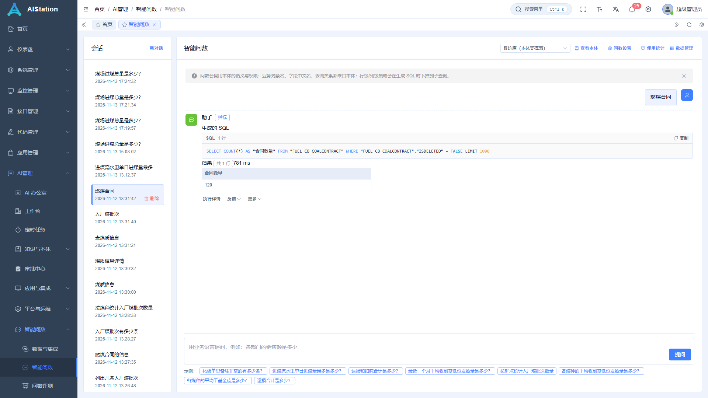

1. 打开 **智能问数**，右上角确认**数据源**（默认「燃煤业务库（本地副本）」）。
2. 底部输入框用**业务语言**提问，例如「煤场进煤总量是多少？」；下面的示例标签可直接点。
3. 回车或点「提问」。结果区给出：**生成的 SQL + 结果表格**（上图：合同数量 = 120，781ms）。
4. 结果下方三个入口：
   - **执行详情**：召回的表、耗时、完整 SQL。
   - **反馈 ▾**：`有用` / `没答对`（填正确口径或正确 SQL）。
   - **更多 ▾**：`存为报表` / `沉淀为指标`（把这次结果变成可复用资产）。
5. 左侧「会话」是历史；点「新对话」开始新的。

**提问技巧**
- 说清楚**对象 + 口径 + 时间 + 维度**：「按煤种统计 2026 年 9 月平均全水分」。
- 要条数说「多少条 / 多少个」；要合计说「合计 / 总量」——系统靠这些词决定走哪条路径。
- 专有叫法（矿点、配仓、标煤）系统未必认识，见第 3 节「加叫法」。

---

## 2. 导入数据集（接入新库/新表）

> 目标：让系统知道「有哪些表、每张表是什么、哪些能查」。**顺序别乱**：数据源 → 同步 → 选表 → 补语义 → 本体 → 指标/术语/样例。

### 2.1 新建数据源

**数据与集成 → 左侧「数据源」→ 新建**

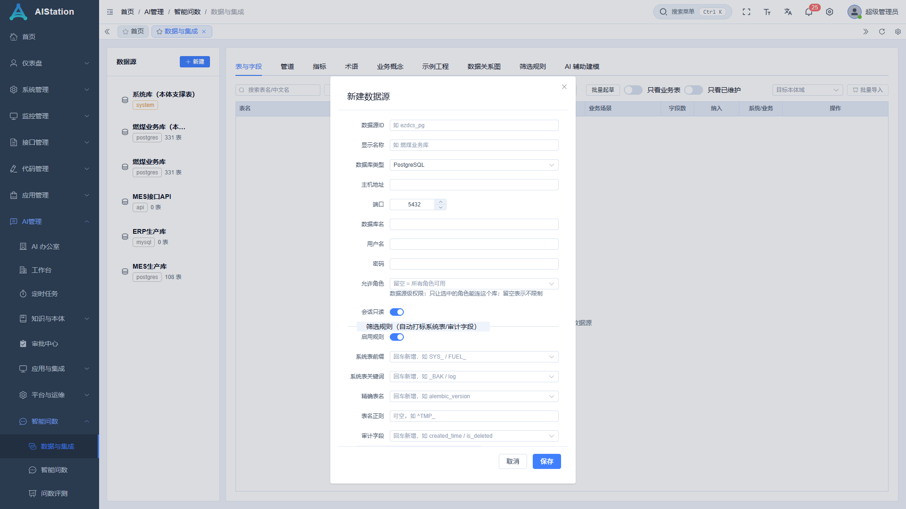

| 字段 | 说明 |
|---|---|
| 数据源 ID | 唯一标识，如 `ezdcs_pg`（建后不可改） |
| 显示名称 | 业务名，如「燃煤业务库」 |
| 数据库类型 | postgres / mysql 等 |
| 主机 / 端口 / 库名 / 用户名 / 密码 | 用**只读账号**（问数只发 SELECT） |
| 会话只读 | 建议开：连接级只读 |
| **允许角色** | **数据源级权限**：留空=所有角色可用；选了则只有这些角色能连 |

保存后点 **测试连接**（真连一次库，慢库约几秒）。

### 2.2 同步表结构

选中数据源 → 点 **同步**（同步 schema）。完成后数据源卡片会显示表数（如「331 表」）。

> 换库结构后要**再同步一次**，否则系统还按旧字段理解。

### 2.3 选表 + 给表/字段补「人话」（最关键）

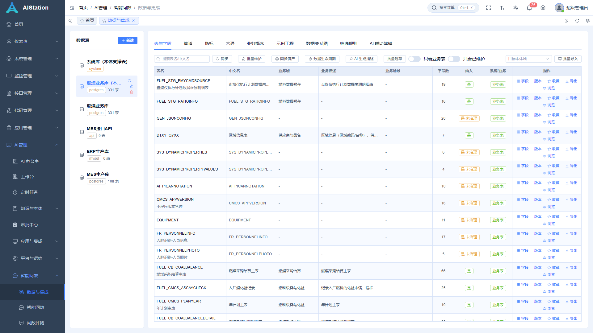

- **纳入** 开关：关掉 = 这张表不参与问数。建议**先只开业务真正要用的几十张**。
- **中文名 / 业务描述 / 业务域 / 业务场景**：一行一行填，或用批量工具。
- **字段数**：点进去可看字段；字段可填描述、枚举、敏感标记。
- **同步资产**：把新表补进资产目录；已有的不会覆盖你的填写。

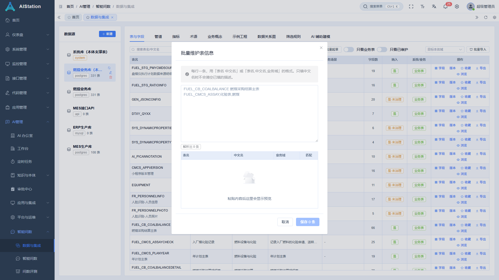

批量方式：**批量维护**（上表）、**批量导入**（右侧按钮，按模板导入）、**AI 生成描述 / 批量起草**（只挑没描述的表，生成草稿后逐条确认）。

> 为什么重要：问数选表靠「名字 + 中文名 + 描述」。都空着，模型只能猜，答错多半在这。

### 2.4 配指标（口径固定，答案最稳）

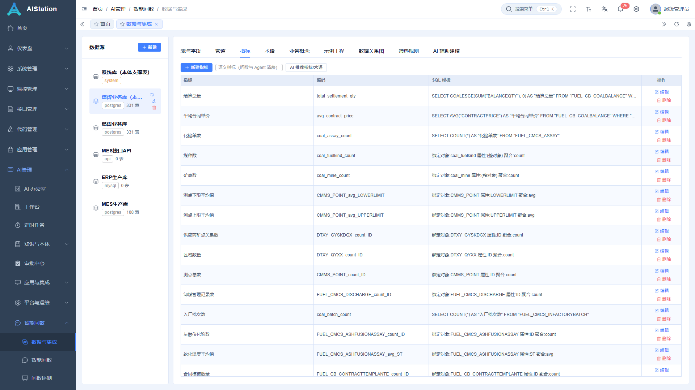

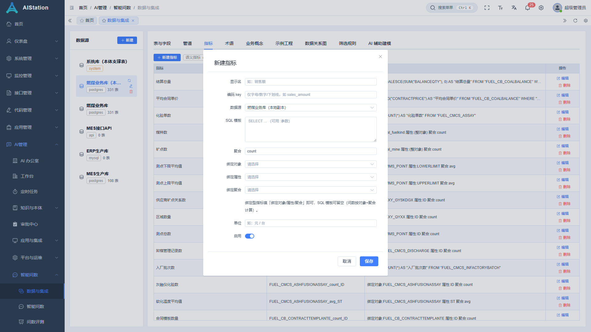

- 点 **新建指标**：填业务名（如「煤场进煤量合计」）、绑定表、聚合方式、SQL 模板/绑定对象、单位、维度。
- 也可以用 **AI 推荐指标 / 批量起草** 生成草稿再确认。
- 指标名**一定写业务名**，不要写「表名+字段码合计」——机器拼出来的名字会抢答（第 3 节怎么处理）。

### 2.5 配术语（业务黑话 → 指标/字段）

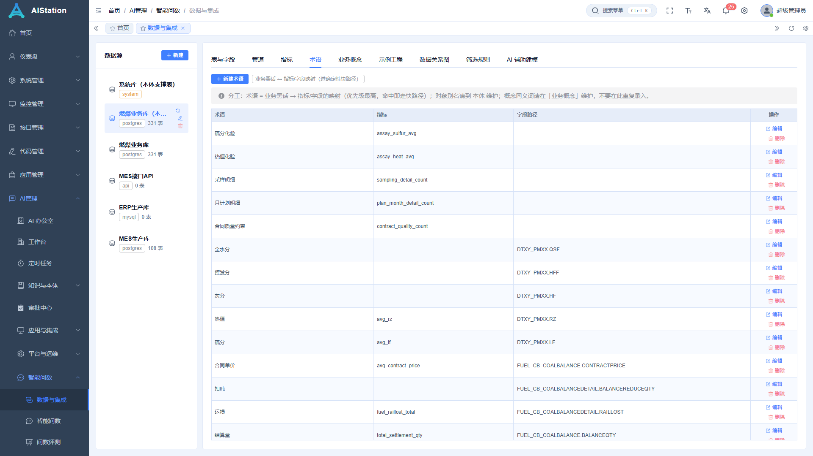

「热值」「标煤」「配仓」这类词，在这里映射到指标或字段；同义词用逗号分隔。

### 2.6 配示例（问句 → 正确 SQL）

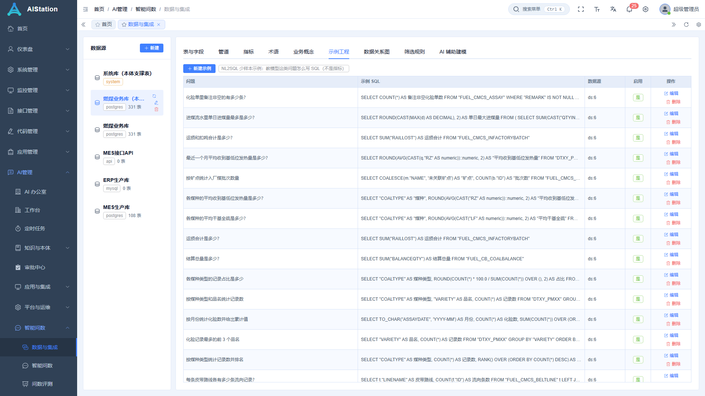

给 3~5 条**口语化**问法的样例，对「模型不懂你们怎么说」帮助最大。

### 2.7 校验表间关系（血缘）

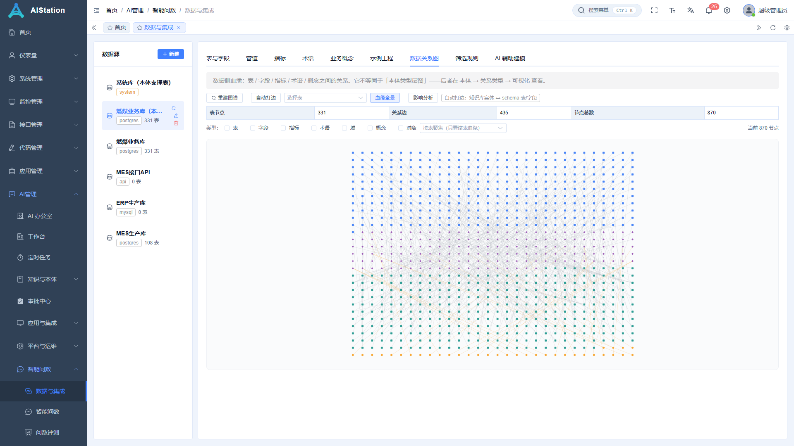

确认 JOIN 路径正确（主表↔明细表↔字典表）。关系错，多表题一定连错。

### 2.8 数据口径（软删 / 时间）

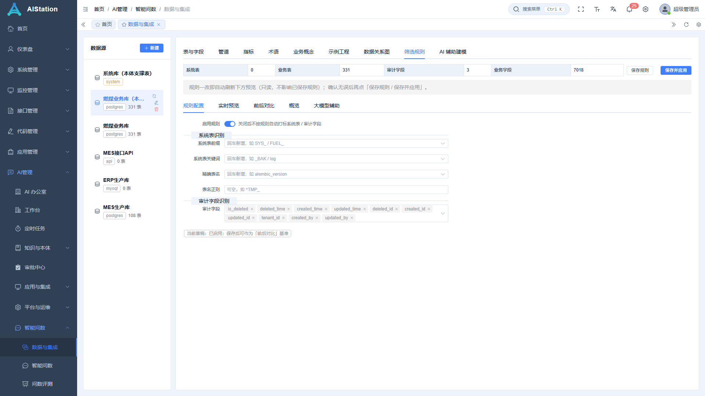

- **软删口径**：列名 + 「已删除」的取值写法（如 `ISDELETED = false`）。
- **时间口径**：一周从周几开始、月份怎么算。
- 这两项会自动补进 SQL，**不用每次提问都写**。

### 2.9 导入本体（对象/属性/关系）

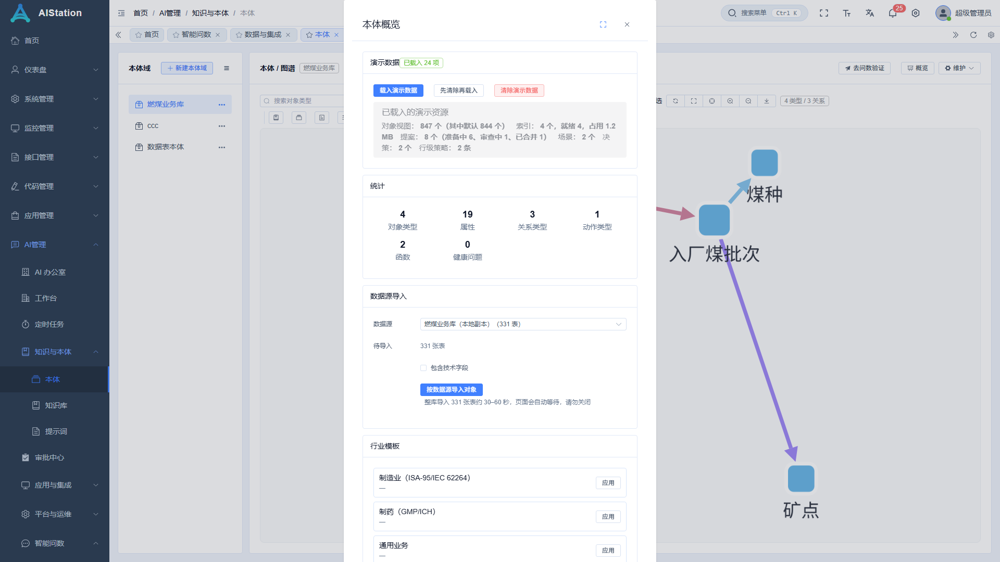

**本体 → 概览 → 数据源导入**：选数据源 → 按需勾「包含技术字段」→ **按数据源导入对象**。
- 331 张表约 30~60 秒，页面会等待，**不要关**。
- 导入后可给重点对象补业务别名（如「入厂批次」）、改支撑表、连关系。

---

## 3. 答错了怎么改（按症状查表）

> 原则：**先体检定位，再改对应模块**。不要一上来改提示词。

| 症状 | 先去哪看 | 怎么改 |
|---|---|---|
| 答成了**另一张表**的数 | 治理 →「问答体检」 | 给两张表都补**中文名/别名/描述**（区分主表/明细）；再在 问数设置 → **实体映射** 把业务词指到对的表 |
| 被**指标快路径抢答**（本该跑 SQL） | 治理 →「问答体检」→「可疑指标」 | `停用`（只关开关）或 `去改名`（改成业务名） |
| 指标名很怪（`XX表QTY合计`） | 同上 | 去指标页改名 |
| **引用悬空**（指标/术语/实体映射指向不存在的表） | 治理 →「问答体检」→「悬空引用」 | 按「怎么处理」列修：补表、改口径、或停用 |
| 新说法/黑话不被识别 | 问数设置 →「让它答得更准」 | ① 术语 加词→指标/字段；② 实体映射 加「词→表」；③ 本体对象加别名 |
| 计数/列举/排序判断错 | 问数设置 → **语言规则** | 改词表（计数词、物理量词、排序词…），页面里可「试一句」验证 |
| SQL 写法不符合习惯 | 问数设置 → **生成规则** | 改提示词规则文案；可按数据源/方言设作用域，有生效预览 |
| 口语化效果差 | 数据与集成 → **示例工程** | 加相近问法的「问句→SQL」 |
| 不知道结论依据 | 结果区 **执行详情** | 看召回的表与 SQL，判断是选表错还是理解错 |

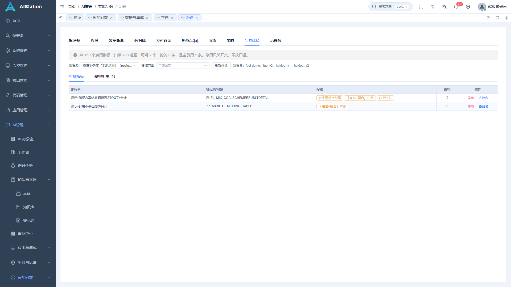

> 上图两条「演示-」开头的指标是**为截图临时造的**：一条名字带字段码（被判可疑），一条引用不存在的表（被判悬空）。截图后已删除——你按图上「停用/去改名」处理自己的即可。

**改完下一句问数就生效**，不用重启。改完建议去「问数评测」跑一轮，确认没退化。

---

## 4. 权限（模块 / 数据源 / 表 / 行 / 列 / 对象）

### 4.1 六层权限一览

| 层级 | 挡什么 | 在哪里配 | 底层字段 |
|---|---|---|---|
| **① 模块级** | 能不能进「智能问数」「治理」「评测」，能不能改策略 | 系统管理 → 角色 → 权限分配 | `module_ai:query:ask`、`module_ai:query:policy:create/update/delete` |
| **② 数据源级** | 这个角色能连哪些库 | 数据与集成 → 数据源 → 编辑 → **允许角色** | `ai_query_datasources.allowed_roles` |
| **③ 表/视图级** | 能查哪些表 | 治理 → **策略**（allow / deny） | `ai_policy`：`resource_kind=table/view` |
| **④ 行级** | 同一张表能看哪些行 | 治理 → 策略（`allow` + **行条件**） | 策略 `condition`（SQL 片段） |
| **⑤ 列级（脱敏）** | 哪些列不能看原值 | 治理 → 策略（`mask` + **脱敏表达式**） | 策略 `mask_expr` |
| **⑥ 对象/属性级** | 哪些业务对象/属性不暴露给助手 | 本体 → 对象/属性 → 可见性 | `ai_ont_object.visibility = hidden` |

> 你说的「**列级**」= ⑤ mask；「**行级**」= ④ 条件；「**实体级/对象级**」= ⑥ 本体可见性（再配合「数据域」限制表范围）。

### 4.2 模块级：谁能用、谁能在治理里改

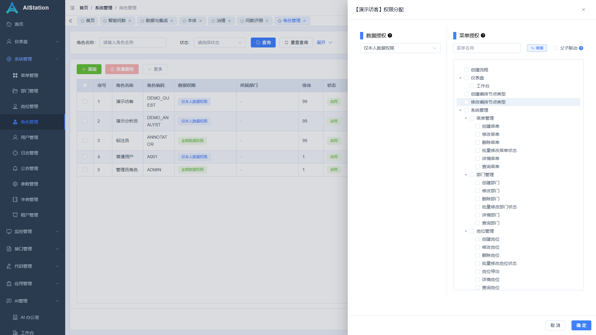

**系统管理 → 角色管理 → 某角色「权限分配」**：
- 左：数据权限（仅本人/本部门/全部）。
- 右：菜单授权树 —— 勾上「智能问数 / 治理 / 问数评测」等菜单，以及具体按钮（如「新建指标」「删除策略」）。

> 只给「智能问数」不给「治理」，这个人就只能提问，看不到策略与体检。

### 4.3 数据源级：这个角色能连哪个库

见 2.1 的「**允许角色**」：留空=全部可用；选了=只对这些角色可见。改完保存即时生效。

### 4.4 表 / 行 / 列策略

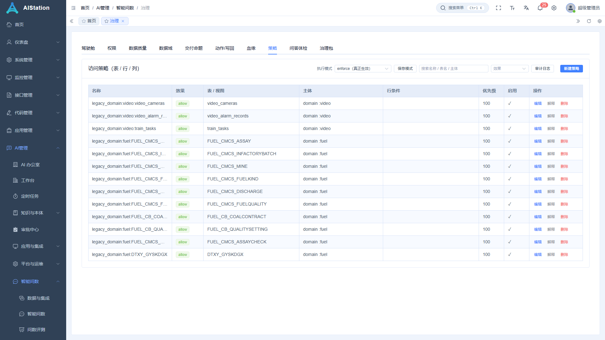

**治理 → 策略 → 新建策略**

| 字段 | 怎么填 |
|---|---|
| 名称 | 如「业务只看本部门」 |
| 优先级 | 数字越大越优先；冲突时 `deny` 优先于 `allow` |
| 资源类型 | `table` / `view` |
| 资源编码 | 表名，如 `FUEL_CMCS_INFACTORYBATCH` |
| 效果 | `allow` 允许 / `deny` 拒绝 / `mask` 脱敏 |
| 主体类型 | `everyone` / `role` / `user`（用户 ID 数字）/ `attr`（如 `dept_id=3`）/ `domain` |
| 行条件 | **只对 allow 生效**：如 `"DEPT_ID" = 3` |
| 脱敏表达式 | **只对 mask 生效**：如 `left("MOBILE",3) || '****'` |

三个典型配置：

```text
# ① 只让「业务员」角色看这张表，且只看本部门
资源=table  FUEL_CMCS_INFACTORYBATCH   效果=allow
主体=attr  dept_id=3                    行条件= "DEPT_ID" = 3

# ② 所有人都不许查工资表
资源=table  SALARY  效果=deny  主体=everyone

# ③ 手机号对「普通用户」脱敏
资源=table  USER_INFO  效果=mask  主体=role=普通用户
脱敏表达式= left("MOBILE", 3) || '****'
```

> 大小写敏感的库：条件里的列名请按真实写法加双引号，否则恒不成立（看起来「全被过滤」）。

### 4.5 执行模式（重要，决定策略是否真的生效）

**治理 → 策略 → 右上角「执行模式」**：

| 模式 | 行为 | 用途 |
|---|---|---|
| `legacy` | 完全按旧规则（不看策略） | 回滚 |
| `shadow` | 只**记计划**、不改写 SQL，审计里能看到「本该拦/本该加条件」 | 灰度验证是否误伤 |
| `enforce` | 真正执行：拒绝 / 加 WHERE / 脱敏 | 正式生效 |

选好后点 **保存模式**，立即生效。建议 `legacy → shadow（观察 1~2 天）→ enforce`。

### 4.6 ABAC 与权限矩阵 / 沙盘

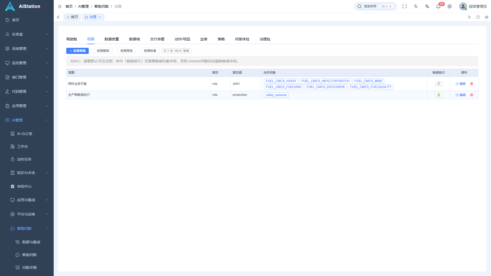

**治理 → 权限**：
- **新建策略**：谁能看哪些表（可按角色/属性/数据域）。
- **权限矩阵**：每个角色 × 每张表的 allow/deny 结论。
- **权限预览 / 权限检查**：选一个用户，列出「他实际能查哪些表」；或对单表解释「为什么被拒」。
- 表格里的「敏感放行」：允许该角色查看敏感字段。

### 4.7 对象级（本体）

**本体 → 对象/属性 → 可见性**：设为 `hidden` 的对象/属性不会暴露给助手（也不会出现在生成 SQL 的候选里）。

### 4.8 怎么验证权限真生效

1. 权限矩阵看结论；2. 权限预览看某用户可见表；3. 权限检查看单表原因；4. 审计日志查每次拒绝/改写；5. 用受限账号真问一句敏感问题，应拒绝而非给数据。

---

## 5. 配置迁移与复用

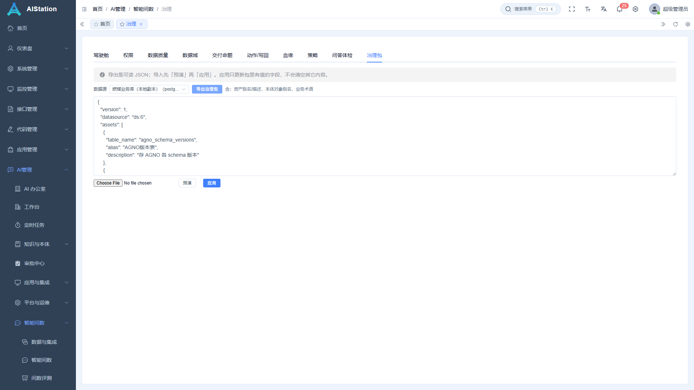

**治理 → 治理包**：
1. 选数据源 → **导出治理包**（上图为导出后的 JSON，含 830 条资产 + 本体别名 + 术语）。
2. 新环境：粘贴/选文件 → **预演**（新增/更新/重复行/未知表）→ **应用**。
3. 应用只更新包里有值的字段，不清空其它内容。

---

## 6. 上线前验收

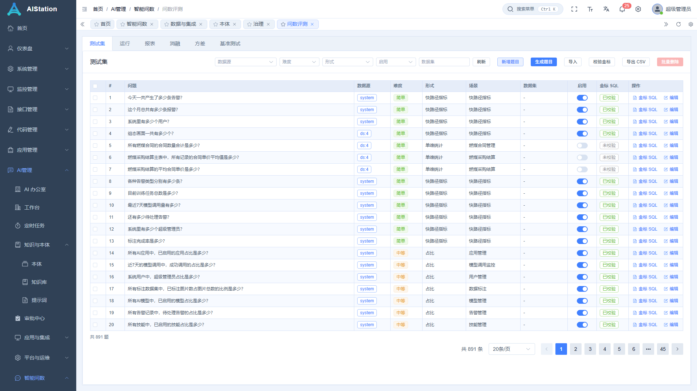

1. **能力**：拿 20~50 条真实问题跑「问数评测」，看准确率与快路径占比。
2. **泛化**：用没参与调优的题（留出集）再跑一轮，差距过大说明「背题」。
3. **权限**：受限账号跑敏感问题，拒绝/脱敏/行过滤都要对，泄漏数应为 0。
4. **性能**：首页、问数、治理各点一遍，接口不应有秒级以上等待。
5. **可迁移**：导出治理包，在另一套环境预演应为「0 差异」。

---

## 7. 日常运维

- **每周**：治理 →「问答体检」，可疑指标/抢答/悬空引用保持 0。
- **改了语义后**：跑一轮评测对比，确认没退化。
- **换环境/备份**：治理 →「治理包」。
- **查改过什么**：问数设置顶部「只查看已修改」。

---

## 8. FAQ

**Q：提问转圈很久 / 报「请求超时」？**
A：生成 SQL 要调模型，通常 3~10 秒；整库导入 30~60 秒属正常。真超时先刷新重试。

**Q：同一问题有时走「快路径」有时走「生成 SQL」？**
A：命中指标（口径固定）走快路径；带时间/分组/排序等模板解释不了的限定，让位给 SQL 生成。设计如此。

**Q：改完别名/指标名要重启或重建索引吗？**
A：不用，下一句立即生效。只有「重建向量索引」需手动点一次。

**Q：怎么知道一条回答用了哪些表、什么 SQL？**
A：结果区 →「执行详情」。

**Q：禁止某角色看某张表，最短路径？**
A：治理 → 策略 → 新建：`资源=table` + `效果=deny` + `主体=role=<角色>`；确认执行模式是 `enforce`。

**Q：列级脱敏和「敏感列」标记的区别？**
A：敏感列是资产字段上的标记（提示与默认拦截）；真正让查询看不到原值的是 `mask` 策略。两者建议同时配。

---

## 附：术语对照（口语 → 系统）

| 你说的 | 系统里的名字 |
|---|---|
| 列级权限 | 策略 `mask` + 脱敏表达式；资产字段「敏感」标记 |
| 行级权限 | 策略 `allow` + 行条件（`condition`） |
| 实体级/对象级权限 | 本体对象/属性 `visibility`；数据域限制表范围 |
| 模块级权限 | 角色 → 权限分配（菜单 + 按钮） |
| 黑话/别名 | 术语、资产中文名、本体别名、实体映射 |
| 让回答更稳 | 指标（口径固定）+ 示例工程（few-shot） |
