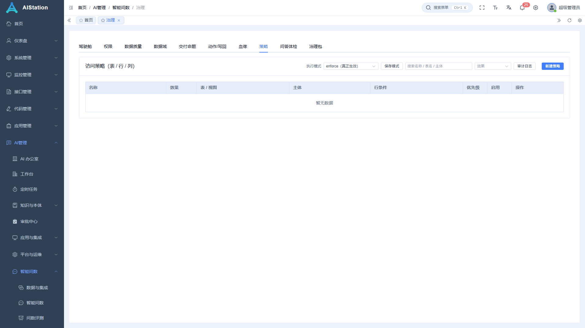

# 智能问数 · 用户手册

> 面向：业务/交付同学（不写代码）。
> 目标：**会提问、会接数据、答错知道去哪改、权限知道在哪配**。
> 读完第 1~3 节就能日常用；权限与验收在第 4~5 节。

---

## 0. 先记住三个页面

| 你要做的事 | 去哪 |
|---|---|
| 提问、看结果、反馈答错 | **智能问数**（`/ai/query`） |
| 接数据源、维护表/字段/指标/术语 | **数据与集成**（`/ai/integration`） |
| 体检质量、配权限、看血缘、导出配置 | **治理**（`/ai/governance`） |
| 跑题库看准确率 | **问数评测**（`/ai/eval`） |

> 一句话分工：**数据与集成 = 维护语义，治理 = 评估与监管，问数 = 使用，评测 = 打分。**

---

## 1. 十分钟上手

1. 打开 **智能问数**，左上角确认**数据源**（默认「燃煤业务库（本地副本）」）。
2. 底部输入框用**业务语言**提问，例如「煤场进煤总量是多少？」；下面的示例标签可以直接点。
3. 回车或点「提问」。结果区会给出：结论 + 表格 + 这条回答走了哪条路径（快路径/生成 SQL）。
4. 结果下方三个入口：
   - **执行详情**：看它生成的 SQL、耗时、召回的表。
   - **反馈 ▾**：`有用` / `没答对`（填正确口径或正确 SQL）。
   - **更多 ▾**：`存为报表` / `沉淀为指标`（把这次结果变成可复用的资产）。
5. 左侧「会话」是历史记录，点「新对话」开新的。

**提问技巧**
- 说清楚**对象 + 口径 + 时间 + 维度**：「按煤种统计 2026 年 9 月平均全水分」。
- 要条数就说「多少条 / 多少个」；要合计就说「合计 / 总量」——系统靠这些词决定走哪条路径。
- 专有叫法（矿点、配仓、标煤）系统未必认识，见第 3 节「加叫法」。

---

## 2. 导入数据集（接入一个新库/新表）

> 目标：让系统知道「有哪些表、每张表是什么、哪些能查」。

### 2.1 新建数据源

**数据与集成 → 左侧「数据源」→ 新建**

填写：

| 字段 | 说明 |
|---|---|
| 名称 | 业务名，如「燃煤业务库」 |
| 类型 | postgres / mysql / sqlite |
| 主机、端口、库名、账号、密码 | 只读账号即可（问数只发 SELECT） |
| 允许角色 | **数据源级权限**：留空=所有角色可用；选了则只有选中角色能连这个库 |

保存后点 **测试连接**（会真连一次库，慢库约几秒）。


### 2.2 同步表结构

选中数据源 → 点 **同步**（同步 schema）。完成后：
- 数据源卡片上会显示表数量（如「331 表」）。
- 右侧 **表与字段** tab 出现表清单。

> 换库结构后要再点一次同步，否则系统还按旧字段理解。

### 2.3 决定「哪些表可查」

**表与字段** tab：
- 每行有「纳入」（included）开关：关掉 = 这张表不参与问数。
- 建议**先只开业务真正要用的表**（几十张），全开会让选表变难、变慢。
- 点 **同步资产** 会把新表补进资产目录；已经有的不会覆盖你的填写。

### 2.4 给表/字段补「人话」（最关键的一步）

同一行可编辑：
- **别名**：业务叫法，如「煤场进煤记录(流水)」「配煤方案主表」。
- **描述**：一句话说明粒度，如「记录每次进煤，一行=一次过磅」。
- 字段级：**描述**、**枚举值**（如煤种编码 → 名称）、**敏感** 标记。

批量方式：
- **批量维护 / 批量导入**（表格里一次改多张表）。
- **AI 生成描述 / 批量起草**：只挑「还没有描述」的表，生成草稿后**逐条确认**再保存（不要盲收）。

> 为什么重要：问数选表靠「名字 + 别名 + 描述」。别名空、描述空，模型只能猜，答错多半出在这。

### 2.5 导入本体（对象/属性/关系）

**本体 → 概览 → 数据源导入**：
- 选数据源 → 勾选「包含技术字段」按需 → **按数据源导入对象**。
- 331 张表约 30~60 秒，页面会等待，不要关。
- 导入后可对重点对象补**业务别名**（如「入厂批次」）、改**支撑表**、配**属性**、连**关系**。

### 2.6 配指标 / 术语 / 示例

- **指标** tab：`新建指标` 手工建（口径固定、答案要稳的）；也可用批量起草/AI 推荐生成草稿再确认。
  - 指标名请写业务名（「煤场进煤量合计」），不要写「表名+字段码合计」。
- **术语** tab：业务黑话 → 指标/字段。例如「热值」→ 指标 `avg_rz`。
- **业务概念 / 示例工程**：给 3~5 条「问句 → 正确 SQL」的样例，对口语化提问帮助最大。
- **数据关系图**：确认表间关联（JOIN 路径）正确，否则多表题会连错。

### 2.7 数据口径（软删 / 时间）

**筛选规则** tab（在数据源上）：
- **软删口径**：列名 + 「已删除」的取值写法（如 `ISDELETED = false`）。
- **时间口径**：一周从周几开始、月份怎么算。
> 这两项会在生成 SQL 时**自动补条件**，不需要每次写在提问里。

---

## 3. 答错了怎么改（按症状查表）

> 原则：**先体检定位，再改对应模块**。不要一上来改提示词。

| 症状 | 先去哪看 | 怎么改 |
|---|---|---|
| 答成了**另一张表**的数 | 治理 →「问答体检」看这条指标/表 | 给两张表都补**别名/描述**（区分主表/明细）；再在问数设置→**实体映射**里把业务词指到对的表 |
| 被**指标快路径抢答**（本该跑 SQL） | 治理 →「问答体检」→「可疑指标」列 | `停用`（只关开关，随时可开回）或 `去改名`（改成业务名） |
| 指标名很怪（`XX表QTY合计`） | 治理 →「问答体检」 | 去指标页改名；批量可用脚本/计划 |
| **引用悬空**（指标/术语/实体映射指向不存在的表） | 治理 →「问答体检」→「悬空引用」 | 按「怎么处理」列修：补表、改口径、或停用 |
| 新说法/黑话不被识别 | 问数设置 →「让它答得更准」 | ① **术语** 加词→指标/字段；② **实体映射** 加「词→表」；③ 本体对象加**别名** |
| 计数/列举/排序判断错 | 问数设置 →「让它答得更准」→ **语言规则** | 改词表（计数词、物理量词、排序词…）；页面里有「试一句」可当场验证 |
| SQL 写法不符合习惯（别名、时间格式、占比） | 问数设置 → **生成规则** | 改提示词规则文案；支持按数据源/方言设作用域，有「预览生效规则」 |
| 口语化提问效果差 | 数据与集成 → **示例工程** | 加 3~5 条相近问法的「问句→SQL」样例 |
| 不知道某条结论依据什么 | 结果区 **执行详情** | 看召回的表、生成的 SQL、耗时；判断是选表错还是理解错 |

> 改完**下一句问数就生效**，不用重启。

**改完要打分**：问数评测 → 用现有题库跑一轮（准确率、快路径占比）；有 A/B 需求时，用「问句语言规则」的规则禁用做对照实验。

---

## 4. 权限（含列级 / 行级 / 对象级）

> 系统的权限分 **5 层**，从上到下越来越细。你只需要按「要挡到哪一层」选一层配。

### 4.1 五层权限一览

| 层级 | 挡什么 | 在哪里配 | 底层字段 |
|---|---|---|---|
| **① 模块级** | 能不能进「智能问数」「治理」「评测」、能不能改策略 | 系统管理 → 角色 → 菜单/按钮权限 | `module_ai:query:ask`、`module_ai:query:policy:create/update/delete` 等 |
| **② 数据源级** | 这个角色能连哪些库 | 数据与集成 → 数据源 → 编辑 → **允许角色** | `ai_query_datasources.allowed_roles` |
| **③ 表/视图级** | 能查哪些表 | 治理 → **策略**（allow / deny） | `ai_policy*`：`resource_kind=table/view` |
| **④ 行级** | 同一张表里能看哪些行 | 治理 → 策略（`allow` + **条件**） | 策略 `condition`（SQL 片段，如 `dept_id = 3`） |
| **⑤ 列级（脱敏）** | 哪些列不能看原值 | 治理 → 策略（`mask` + **脱敏表达式**） | 策略 `mask_expr`（如 `left(mobile,3) || '****'`） |
| ⑥ 对象/属性级（本体） | 哪些业务对象/属性不暴露给助手 | 本体 → 对象/属性 → 可见性 | `ai_ont_object.visibility = hidden` |

> 你口中的「**列级**」= ⑤ mask；「**行级**」= ④ condition；「**实体级/对象级**」= ⑥ 本体 visibility（外加「数据域」限制表范围）。

> ⚠️ 「治理」里有两个相邻页签，别混：
> - **权限**：ABAC 规则（谁 → 哪些表/数据域），配「某角色能看哪些表」，并可做**权限矩阵 / 沙盘预览**。
> - **策略**：表级 allow/deny、**行级条件**、**列级脱敏**，以及整台引擎的**执行模式**（legacy/shadow/enforce）。

### 4.2 配一条策略（表/行/列都在这一个界面）

**治理 → 策略 → 新建策略**

| 字段 | 怎么填 |
|---|---|
| 名称 | 如「财务看全量 / 业务只看本部门」 |
| 优先级 | 数字越大越优先；冲突时先看优先级，`deny` 优先于 `allow` |
| 资源类型 | `table` 或 `view` |
| 资源编码 | 表名，如 `FUEL_CMGS_INFACTORYBATCH` |
| 效果 | `allow` 允许 / `deny` 拒绝 / `mask` 脱敏 |
| 主体类型 | `everyone` 所有人 / `role` 角色 / `user` 用户ID（数字）/ `attr` 属性（如 `dept_id=3`）/ `domain` 数据域 |
| 条件 | **只对 allow 有效**：行级过滤条件，例如 `"DEPT_ID" = 3` |
| 脱敏表达式 | **只对 mask 有效**：如 `left("MOBILE",3) || '****'` |

**三个典型配置**

```text
# ① 只让「业务员」角色看这张表，并且只看本部门数据
资源=table  FUEL_CMGS_INFACTORYBATCH   效果=allow
主体=attr  dept_id=3                    条件= "DEPT_ID" = 3

# ② 所有人都不许查工资表
资源=table  SALARY  效果=deny  主体=everyone

# ③ 手机号对「普通用户」角色脱敏
资源=table  USER_INFO  效果=mask  主体=role=普通用户
脱敏表达式= left("MOBILE", 3) || '****'
```

> 字段大小写：有些库是**大小写敏感**的，写条件时请按库里的真实写法加双引号。

### 4.3 策略的三种执行模式（重要）

| 模式 | 行为 | 用途 |
|---|---|---|
| `legacy` | 完全按旧规则（不看策略） | 回滚用 |
| `shadow` | 策略只**记计划**、不真正改写 SQL，日志里能看到「本该拦/本该加条件」 | 灰度验证：先看会不会误伤 |
| `enforce` | 真正执行：拒绝 / 加 WHERE / 脱敏 | 正式生效 |

**在哪里切**：**治理 → 策略 → 右上角「执行模式」** 下拉选 `legacy / shadow / enforce` → 点 **保存模式**，立即生效（读的是 `ai_query_settings.policy_engine`）。

建议流程：`legacy → shadow（观察 1~2 天审计日志，看本该拦的有没有误伤）→ enforce`。



### 4.4 怎么验证权限真的生效

1. **治理 → 权限 → 权限矩阵**：看每个角色对每张表的 allow/deny 结论。
2. **权限沙盘（按用户/按角色预览）**：选一个用户，列出「他实际能查哪些表」，以及每条策略的落点。
3. **权限解释（为什么被拒）**：对单表查一次解释，输出命中的策略与原因。
4. **审计日志**：每次拒绝 / 改写都会落库，可按人、按表查。
5. 端到端：用受限账号登录，直接问一句涉及敏感表的话，应得到「无权限」而不是数据。

### 4.5 常见坑

- **策略写了但没生效**：先确认 `policy_engine=enforce`（shadow 不会真拦）。
- **行级条件没加双引号**：大小写敏感的库会把列名折成小写 → 条件恒不成立（看起来「全都被过滤掉了」）。
- **只配了表级 allow，却以为行级也生效**：表级 allow 只是「允许查」，行级要在 `condition` 里写清楚。
- **deny 与 allow 同时命中**：`deny` 优先；不确定时把优先级写清楚。
- **脱敏后仍能算出原值**（如求平均）：脱敏表达式应直接作用在输出列上，不要只在展示层处理。
- **收窄权限后问数「什么都查不到」**：先去权限沙盘看该用户的可见表集合，常见是漏配了域/表 allow。

---

## 5. 上线前验收清单

1. **能力**：拿 20~50 条真实业务问题跑「问数评测」，看准确率与快路径占比。
2. **泛化**：用没参与调优的题（留出集）再跑一轮，两者差距过大说明「背题」了。
3. **权限**：用受限账号跑敏感问题，确认拒绝/脱敏/行过滤都对；泄漏数应为 0。
4. **性能**：首页、问数、治理页各点一遍，接口不应有秒级以上等待（≥10 秒要查）。
5. **可维护性**：把配置导出一次（治理 →「治理包」），确认能在另一套环境导入并「预演 0 差异」。

---

## 6. 日常运维

- **每周**：治理 →「问答体检」——可疑指标、抢答、悬空引用应保持 0；新增的按提示处理。
- **改了语义之后**：用问数评测跑一轮对比，确认没退化。
- **换环境/备份**：治理 →「治理包」导出 JSON（资产别名/描述、本体别名、术语）；新环境先「预演」看差异，再「应用」。
- **调过的开关**：问数设置顶部有「只查看已改」筛选，能列出你改过的项。

---

## 7. FAQ

**Q：提问后转圈很久 / 报「请求超时」？**
A：先看结果区是否有「执行详情」。若接口超时，把页面刷新重试；仍超时说明这条链路慢（生成 SQL 需要调模型，通常 3~10 秒）。整库导入这类操作本来就要 30~60 秒，属正常。

**Q：为什么同一个问题，有时走「快路径」有时走「生成 SQL」？**
A：命中指标（口径固定）就走快路径；带时间/分组/排序等模板解释不了的限定就会让位给 SQL 生成。这是设计而非缺陷。

**Q：改完别名/指标名，需要重启或重建索引吗？**
A：不需要，下一句问数即生效。只有「重建向量索引」这类操作需要手动点一次。

**Q：怎么知道一条回答用了哪些表、什么 SQL？**
A：结果区 →「执行详情」。

**Q：我要禁止某个角色看某张表，最短路径？**
A：治理 → 策略 → 新建：`资源=table` + `效果=deny` + `主体=role=<角色>`，保存后确认 `policy_engine=enforce`。

**Q：列级脱敏和「敏感列」标记有什么区别？**
A：「敏感列」是资产字段上的标记（用于提示与默认拦截）；真正让查询看不到原值的是 `mask` 策略的脱敏表达式。两者建议同时配。

---

## 附：术语对照（口语 → 系统）

| 你说的 | 系统里的名字 |
|---|---|
| 列级权限 | 策略 `mask` + 脱敏表达式；资产字段「敏感」标记 |
| 行级权限 | 策略 `allow` + 条件（`condition`） |
| 实体级/对象级权限 | 本体对象/属性 `visibility`；数据域（domain）限制表范围 |
| 模块级权限 | 角色 → 菜单/按钮权限（`module_ai:*`） |
| 黑话/别名 | 术语、资产别名、本体别名、实体映射 |
| 让回答更稳 | 指标（口径固定）+ 示例工程（few-shot） |
